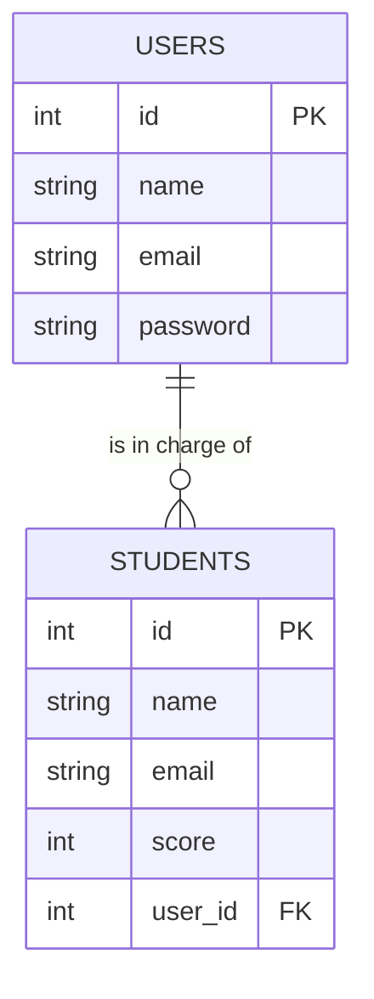

> 🇯🇵 Original (Japanese version): [リレーショナルデータベース入門.md](<../../../2年生_システム開発実践/前期/2026_07_23/リレーショナルデータベース入門.md>) <!-- original-ja-link -->

## What You Will Learn in This Article

- Tables, rows, and columns
- Primary keys
- Foreign keys and how tables connect
- Why we split data into separate tables

## A Database = A Collection of Organized Tables

A "database" is a system for organizing and storing data in tables, rather than keeping notes on scattered pieces of paper. What makes an RDB (relational database) special is that it can connect several of these tables (= relate them) and work with them together.

## Tables, Rows, and Columns

This app has two tables with different roles. Let's use each of them as an example to learn the names of the parts.

### 🎓 The students table (student data)

| id | name | email | score |
|----|------|-------|-------|
| 1  | 田中太郎 | tanaka@example.com | 80 |
| 2  | 佐藤花子 | sato@example.com | 95 |

- **Table**: the table itself (you create multiple tables for different purposes)
- **Column**: a vertical item such as `id`, `name`, `email`, or `score`
- **Row (record)**: one entry of data (here, the information for one student)

### 🔑 The users table (login information for teachers and administrators)

| id | name | email | password |
|----|------|-------|----------|
| 1  | 小山先生 | koyama@example.com | $2y$10$abcdefGhIjKlmn...(hashed) |
| 2  | 田中先生 | tanaka-t@example.com | $2y$10$OpQrStUvWxYz...(hashed) |

- **Table**: `users` (account information for logging in; a different role from students)
- **Column**: `id`, `name`, `email`, `password`
- **Row (record)**: one entry of data (here, the login information for one teacher or administrator)

> 💡 The `password` is not saved as the exact string that was typed in (plain text). It is saved after an irreversible conversion called hashing. This way, even if the contents of the database leak, nobody can tell what the original password was.

## Primary Key: An ID That Uniquely Identifies Data

If you search only by `name`, you can't tell people apart when two of them have the same name. That's why we use a number that is unique to each row (the **primary key**). The `id` in the tables above is the primary key, so if you say "give me the data where id = 1," you narrow it down to exactly one record: 田中太郎's data. It's easy to picture a primary key as something like a national ID number or a membership number.

## Foreign Key: How Tables Connect

The essence of an RDB (= where the word "relational" comes from) is that it can link multiple tables to each other by ID.

This app has two tables: the `users` table for logging in (teacher and administrator accounts) and the `students` table for student data. At the moment, these two are independent tables that are not connected by ID.

If you ever want to record "which teacher (user) registered or is in charge of which student (student)," you connect them by adding a `user_id` column to the `students` table.

If `STUDENTS.user_id` (the foreign key) references `USERS.id` (the primary key), you can represent a one-to-many relationship in which one teacher (user) is in charge of multiple students.

## Why Split Data into Separate Tables?

If you put everything into one table without splitting it, the name and email address of the same teacher get repeated once for every student that teacher is in charge of.

| student_id | student_name | staff_name | staff_email |
|-----------|-------|-------------|---------------|
| 101 | 田中花子 | 小山先生 | koyama@example.com |
| 103 | 田中次郎 | 小山先生 | koyama@example.com |

With this setup, when Koyama-sensei changes their email address, you have to find and update every matching row, and it's easy to miss some. If you split the data into a users table and a students table and link them by ID, Koyama-sensei's information is stored in only one place, so you only need to update it there. This idea of "splitting tables to avoid duplication" is called **normalization**.

## Summary

- A database is a system for storing data in an organized way
- An RDB manages data in the form of "tables," and a table is made up of "columns (items)" and "rows (one entry of data each)"
- A primary key is a marker (ID) that tells each record apart without duplicates
- A foreign key is a mechanism that references the primary key of another table to link tables together
- Splitting tables and linking them prevents the same information from being duplicated and makes the data easier to keep organized

Later on, you'll also encounter topics such as "SQL," "indexes," and "transactions," but for now it's enough to understand these basic concepts.
