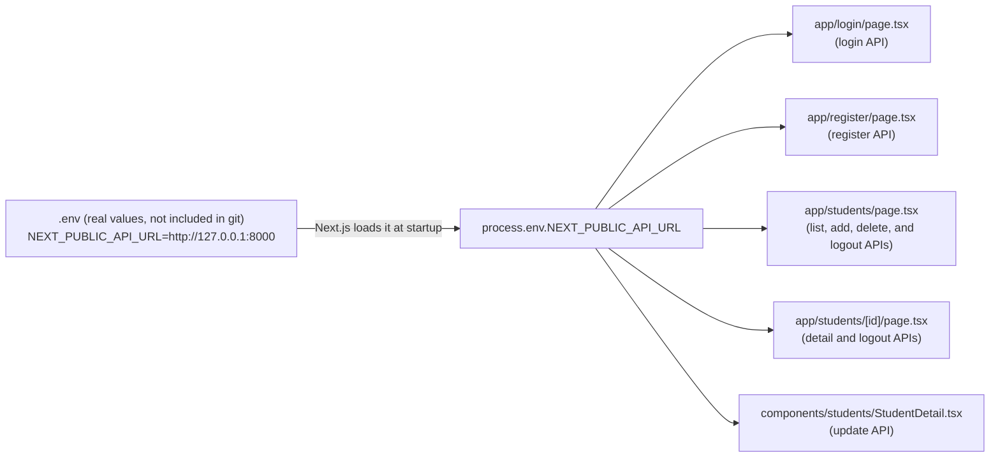
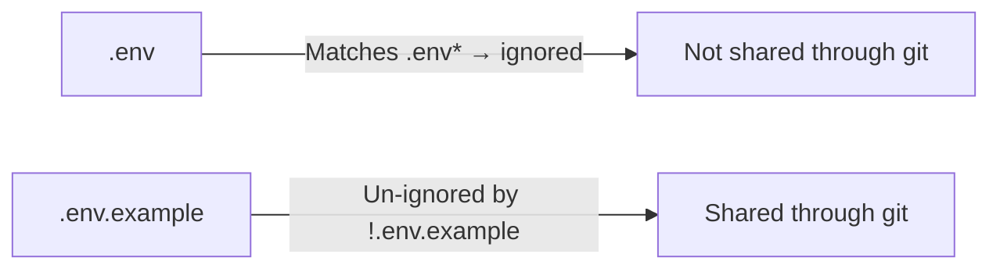

# Lesson 26 | Moving the API URL into an Environment Variable (.env) - Implementation Steps

> 🇯🇵 Original (Japanese version): [2026_07_30_実装.md](<../../../2年生_システム開発実践/前期/2026_07_30/2026_07_30_実装.md>) <!-- original-ja-link -->

## Today's Goals

- Consolidate the `http://localhost:8000` / `http://127.0.0.1:8000` URLs hard-coded across the pages of `school-frontend` in one place
- Create a `.env` file and manage the API URL as the environment variable `NEXT_PUBLIC_API_URL`
- Share `.env.example` (a template without real values) through git, and keep `.env` (the real values) out of git
- Update every `fetch` call to use `process.env.NEXT_PUBLIC_API_URL`

> **Where this fits:** Until now, we wrote the API URL directly in each file, like `fetch("http://127.0.0.1:8000/api/students")`. With this approach, when the URL differs between development and production, you have to rewrite it in many places across files, and missing one can cause bugs. This time, we learn the idea of "not embedding values that might change (URLs, API keys, and so on) in the code, and moving them out into environment variables instead."

---

## The Big Picture: What We Are Building



> 💡 **Think of it like... an address book that keeps every address in one place**
>
> Until now, it was as if every time you sent a letter to a friend, you wrote the address yourself: "Tanaka's house is at 3-1 ◯◯ Town." If Tanaka moved, you would have to rewrite every letter you had written. `.env` is like an "address book": you write the address (the API URL) in just one place, and each letter (the fetch in each file) refers to "Tanaka's address in the address book." Even if Tanaka moves (the URL changes), you only need to update the address book once.

### Why Keep `.env` and `.env.example` Separate?

In this app, `.env` contains no secret values, but in general it holds values you don't want others to see, such as database passwords and API keys. That's why `.env` itself is excluded with `.gitignore` and is not shared through git. On the other hand, the team does want to share "which variable names are needed," so we commit only `.env.example`, with empty (or dummy) values. Anyone who joins the project copies `.env.example` to create `.env`, then fills in the values for their own environment.

### File Structure (What We Touch This Time)

| Symbol | Meaning |
|---|---|
| 🆕 New | Create a new file |
| ➕ Add | Add code to an existing file |
| 🔁 Replace | Rewrite existing logic |

```
school-frontend/
├── .env                                       🆕 New (real values, not included in git)
├── .env.example                               🆕 New (template, included in git)
├── .gitignore                                 ➕ Un-ignore only .env.example
├── app/login/page.tsx                         🔁 Replace the fetch URL with the environment variable
├── app/register/page.tsx                      🔁 Replace the fetch URL with the environment variable
├── app/students/page.tsx                      🔁 Replace the fetch URL with the environment variable (4 places)
├── app/students/[id]/page.tsx                 🔁 Replace the fetch URL with the environment variable (2 places)
└── components/students/StudentDetail.tsx      🔁 Replace the fetch URL with the environment variable
```

---

## Step 1 | Create `.env`

**🆕 New file** — Create `.env` directly under `school-frontend`.

```bash
# ▼ school-frontend/.env
NEXT_PUBLIC_API_URL=http://127.0.0.1:8000
```

- The key point is to start the key name with `NEXT_PUBLIC_`. Next.js embeds only environment variables prefixed with `NEXT_PUBLIC_` into the build so they can also be read in the browser (client components). All the `fetch` calls we rewrite this time are inside components marked with `"use client"`, so this prefix is required.
- Environment variables without `NEXT_PUBLIC_` (for example, a database password) can only be read by server-side code. Don't add the prefix to values you don't want exposed to the browser.

---

## Step 2 | Create `.env.example`

**🆕 New file** — Create a file with the same contents to share with the team as a template. The URL contains no secret information, so use the same value.

```bash
# ▼ school-frontend/.env.example
NEXT_PUBLIC_API_URL=http://127.0.0.1:8000
```

> ⚠️ When you handle values that are truly secret, such as passwords and API keys, don't write the real values in `.env.example`. Leave them empty, like `DB_PASSWORD=`, or use dummy values like `your-api-key-here`.

---

## Step 3 | Un-ignore Only `.env.example` in `.gitignore`

The `.gitignore` that `create-next-app` provides from the start has a wildcard rule, `.env*`, like this.

```
# env files (can opt-in for committing if needed)
.env*
```

This rule ignores "every file whose name starts with `.env`," which includes not only `.env` but also `.env.example`. As a safety measure against accidentally committing secrets, it is the right setting, but it also takes `.env.example`, the file we actually want to share, out of git. So we add one line that makes `.env.example` an exception and stops it from being ignored.

**➕ Add**

```
# env files (can opt-in for committing if needed)
.env*
!.env.example
```

Putting `!` at the start means "don't ignore this pattern (= track it in git)." The order matters: first ignore everything with `.env*`, then bring back only `.env.example` with `!.env.example` (in the reverse order, it doesn't work).

With this setting, the two files are handled as follows.



---

## Step 4 | Replace the fetch URLs with the Environment Variable

At this point `.env` is ready, but the actual code is still using `http://127.0.0.1:8000` directly. Rewrite the fetch calls in each file as template literals that use `process.env.NEXT_PUBLIC_API_URL`.

### 4-1. `app/login/page.tsx`

**🔁 Replace**

```tsx
// Before
const res = await fetch("http://127.0.0.1:8000/api/login", {

// After
const res = await fetch(`${process.env.NEXT_PUBLIC_API_URL}/api/login`, {
```

### 4-2. `app/register/page.tsx`

**🔁 Replace**

```tsx
// Before
const res = await fetch("http://127.0.0.1:8000/api/register", {

// After
const res = await fetch(`${process.env.NEXT_PUBLIC_API_URL}/api/register`, {
```

### 4-3. `app/students/page.tsx` (4 places)

**🔁 Replace** — Rewrite each of the four fetch calls: fetching the list, adding a student, deleting a student, and logging out.

```tsx
// Fetch list (Before → After)
const res = await fetch("http://127.0.0.1:8000/api/students", {
const res = await fetch(`${process.env.NEXT_PUBLIC_API_URL}/api/students`, {

// Add student (Before → After)
const res = await fetch("http://127.0.0.1:8000/api/students", {
const res = await fetch(`${process.env.NEXT_PUBLIC_API_URL}/api/students`, {

// Delete student (Before → After)
const res = await fetch(`http://127.0.0.1:8000/api/students/${id}`, {
const res = await fetch(`${process.env.NEXT_PUBLIC_API_URL}/api/students/${id}`, {

// Logout (Before → After)
await fetch("http://127.0.0.1:8000/api/logout", {
await fetch(`${process.env.NEXT_PUBLIC_API_URL}/api/logout`, {
```

### 4-4. `app/students/[id]/page.tsx` (2 places)

**🔁 Replace** — This file was originally written with `http://localhost:8000` (written as `localhost`, not `127.0.0.1`). The very fact that the notation is inconsistent shows why we need to "keep the URL in one place."

```tsx
// Fetch details (Before → After)
const res = await fetch(`http://localhost:8000/api/students/${params.id}`, {
const res = await fetch(`${process.env.NEXT_PUBLIC_API_URL}/api/students/${params.id}`, {

// Logout (Before → After)
await fetch("http://localhost:8000/api/logout", {
await fetch(`${process.env.NEXT_PUBLIC_API_URL}/api/logout`, {
```

### 4-5. `components/students/StudentDetail.tsx`

**🔁 Replace**

```tsx
// Before
const res = await fetch(`http://localhost:8000/api/students/${student.id}`, {

// After
const res = await fetch(`${process.env.NEXT_PUBLIC_API_URL}/api/students/${student.id}`, {
```

> 💡 Places where the original string used double quotes, like `"http://..."` (a regular string), also need to be changed to template literals with backticks (\` \`) so that `${...}` can be embedded. Places that were already template literals (such as `` `http://127.0.0.1:8000/api/students/${id}` ``) keep their backticks; just replace the string part inside.

---

## Checking That It Works

```bash
# Backend
cd Laravel && php artisan serve   # http://localhost:8000

# Frontend
cd school-frontend && npm run dev # http://localhost:3000
```

> ⚠️ Whenever you create `.env` or change its values, stop `npm run dev` and restart it. Next.js reads environment variables when it builds and starts, so if you edit `.env` while the server is running, hot reload won't pick up the change.

| What to check | Action | Expected result |
|---|---|---|
| No hard-coded URLs left in the code | Run `grep -rn "localhost:8000\|127.0.0.1:8000" app components` | Nothing is printed (all URLs have been replaced with references to `process.env`) |
| Login | Log in from `/login` | You can log in as before and are taken to `/students` |
| List, detail, add, delete | Go through each operation on `/students` | Everything works as before (only how the URL is written has changed; the behavior is the same) |
| Switching the environment variable | Temporarily change the value in `.env` to a different port (for example, one that doesn't exist) and restart | Connecting to the API fails = this confirms the value in `.env` is really being used (change it back afterward) |
| How it looks in git | Run `git status` | `.env` is not shown (it is ignored), and `.env.example` is shown as an untracked file |

---

## Summary

| Concept | Where we handled it this time |
|---|---|
| Moving values into environment variables | `NEXT_PUBLIC_API_URL` in `.env` |
| The condition for reading environment variables on the client side | The `NEXT_PUBLIC_` prefix |
| Keeping secrets out of git | `.env*` in `.gitignore` |
| Sharing only the template with the team | `.env.example` + un-ignoring it with `!.env.example` |
| When environment variable changes take effect | You need to restart the development server after changing `.env` |

## Completion Checklist (Definition of Done)

- [ ] `school-frontend/.env` sets `NEXT_PUBLIC_API_URL=http://127.0.0.1:8000`
- [ ] `school-frontend/.env.example` has been created, containing the same variable name as a template
- [ ] `!.env.example` has been added to `.gitignore`, so only `.env.example` can be tracked in git
- [ ] The fetch calls in `app/login/page.tsx` / `app/register/page.tsx` / `app/students/page.tsx` / `app/students/[id]/page.tsx` / `components/students/StudentDetail.tsx` all go through `process.env.NEXT_PUBLIC_API_URL`
- [ ] `grep -rn "localhost:8000\|127.0.0.1:8000" app components` finds nothing
- [ ] After restarting `npm run dev`, login → list → detail → add → delete all work as before
- [ ] `git status` doesn't show `.env`, and only `.env.example` is eligible to be tracked

## Startup Commands

```bash
# Backend
cd Laravel && php artisan serve   # http://localhost:8000

# Frontend
cd school-frontend && npm run dev # http://localhost:3000
```
