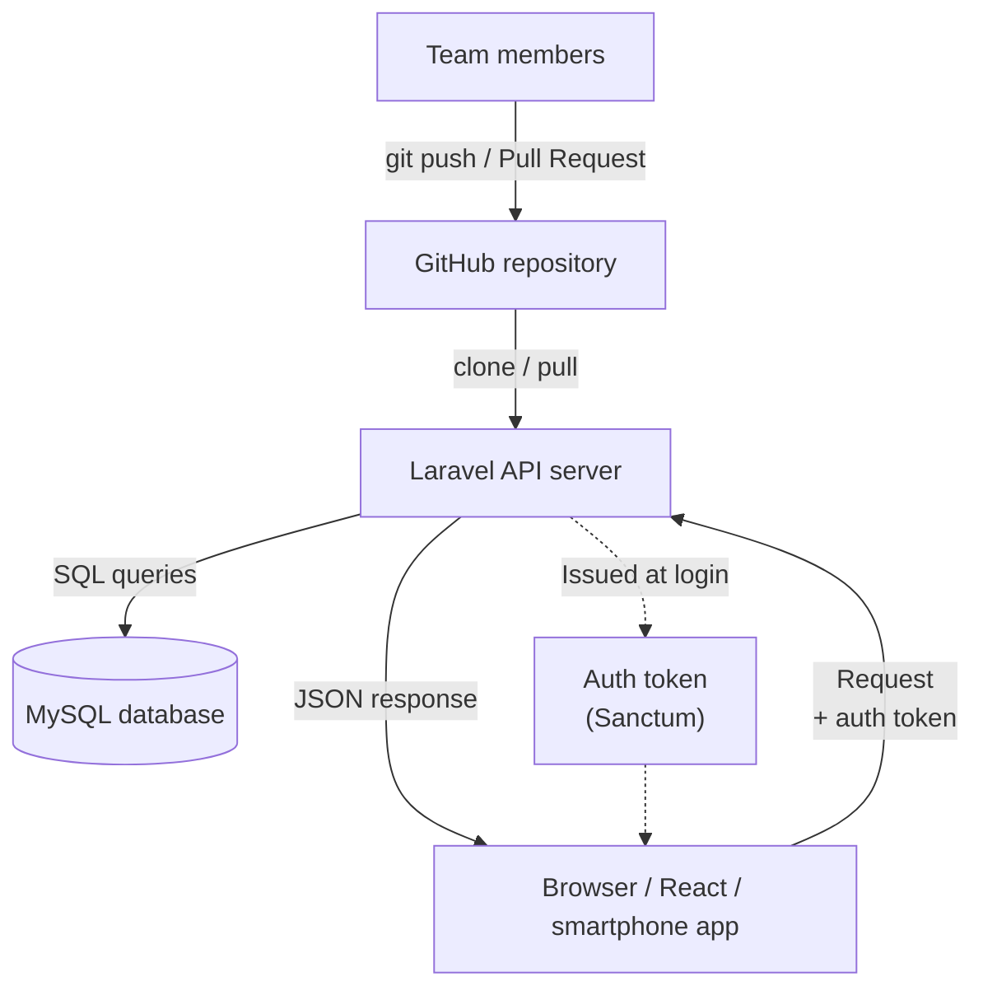
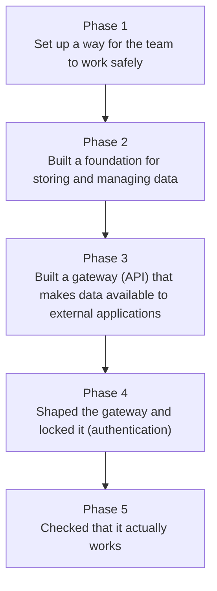

# The Development Flow: From Zero to a Working API

> 🇯🇵 Original (Japanese version): [開発の流れ_まとめ.md](<../../2年生_システム開発実践/前期/開発の流れ_まとめ.md>) <!-- original-ja-link -->

---

## Introduction

This document explains not only "what we did" but also "**why we did it in that order**."

---

## The Big Picture: What We Built

### Overall Diagram of the Finished System



### The Five Phases

| Phase | Theme | Keywords | Lesson |
|---------|--------|-----------|---------|
| 1 | Getting ready for team development | Branches, PRs, reviews | 04/30 |
| 2 | Building the app's foundation | Laravel, DB, migrations | 05/06 |
| 3 | Building a gateway for data | REST API, JSON, routing | 05/14 |
| 4 | Shaping and protecting it | Resource, validation, Sanctum | 05/21 |
| 5 | Checking that it works | curl, browser testing | 05/28 |

---

## Phase 1: Getting Ready for Team Development

### What We Did

We learned about Git branches, merging, pull requests (PRs), and code review,
and put the app on GitHub as a team so that everyone could run it.

### Why It Was Needed

> 💡 **Think of it like... managing blueprints on a construction site**
>
> When several contractors build a large building together, it would be chaos if everyone
> wrote directly on "the same original blueprint." So each contractor writes on "their own copy (a branch),"
> and when they're done, the copies are checked together (reviewed) before the changes go into the original.

In team development, several people edit the same files at the same time.
Creating a branch lets you "develop a new feature without breaking the main code."
A PR is a request asking, "May I add this code to main?"
A review is where the team checks whether that code is correct and easy to read.

> ⚠️ **Without this...** one person's code can overwrite and erase someone else's work.
> "It was working a minute ago, and now it's broken" happens all the time.

### What You Can Do After This Phase

- Create a branch and work on it with `git switch -c feature/xxxx`
- Share your work with the team with `git push origin feature/xxxx`
- Create a PR on GitHub and request a review
- Fix your code based on review comments

### Detailed Steps

→ [`2026_04_30/2026_04_30.md`](2026_04_30/2026_04_30.md)

---

## Phase 2: Building the App's Foundation

### What We Did

We created a Laravel project, prepared a database (`school_api`),
and defined and created the `students` table. Then we loaded 10 rows of test data and started the server.

### Why It Was Needed

> 💡 **Think of it like... building a restaurant kitchen**
>
> To serve dishes (API responses) to customers,
> you first need a kitchen (Laravel) and a place to store ingredients (the database).
> If you prepare the kitchen's blueprint (migrations) first,
> anyone on the team can recreate the same environment.

Laravel is "a box that comes with commonly used features (routing, DB operations, authentication, and more) built in."
Migrations are the design documents for the database. Just by running `php artisan migrate`,
everyone on the team can recreate the same table structure on their own machine.
Seeders generate test data automatically, saving you the trouble of entering data by hand.

> ⚠️ **Without this...** even if you write API code, there is nowhere to store the data,
> so the data disappears with every request.

### What You Can Do After This Phase

- Create a project with `composer create-project laravel/laravel`
- Configure DB connection settings in `.env`
- Generate a model, migration, and factory all at once with `php artisan make:model Student -mf`
- Create tables with `php artisan migrate`
- Load test data with `php artisan db:seed`
- Start a local server with `php artisan serve`

### Detailed Steps

→ [`2026_05_06/20260506.md`](2026_05_06/20260506.md)

---

## Phase 3: Building a Gateway for Data

### What We Did

We learned the concepts behind REST APIs (URL × HTTP method, JSON responses, status codes),
created `StudentController`, and implemented five endpoints, including `GET /api/students`.

### Why It Was Needed

> 💡 **Think of it like... the buttons on a vending machine**
>
> A vending machine has buttons like "Cola," "Tea," and "Water,"
> and when you press one, the matching product comes out.
> API endpoints work the same way:
> for example, `GET /api/students` means "get all students," while `DELETE /api/students/3` means "delete student 3."
> The combination of the URL and HTTP method determines what happens.

The Blade app we built in the first year returned HTML pages.
An API returns only JSON data instead.
Using JSON means that **different interfaces**, such as React, Vue, and smartphone apps,
**can all use the same data**.

> ⚠️ **Without this...** the frontend and the server can't talk to each other.
> A React app wouldn't know where to send an API request.

### What You Can Do After This Phase

- Understand REST API URL design (resource names and HTTP methods)
- Generate an API controller with `php artisan make:controller Api/StudentController --api`
- Add routes to `routes/api.php`
- Return a JSON response with `response()->json()`
- Understand what HTTP status codes (200, 201, 404, 422) mean

### Detailed Steps

→ [`2026_05_14/20260514.md`](2026_05_14/20260514.md)

---

## Phase 4: Shaping and Protecting It

### What We Did

We standardized the response format with `StudentResource` and added validation to check input data.
We also implemented authentication (login, token issuing, and logout) with Laravel Sanctum.

### Why It Was Needed

> 💡 **Think of it like... a standard shipping label format + a building entry pass**
>
> On a shipping label, the "sender, recipient, and item name" are written in fixed places.
> Because the format is standardized, the recipient can process the shipment without confusion.
> `StudentResource` is the "label template" that defines the response format.
>
> A Sanctum token is an "entry pass."
> Only people who have the entry pass (token) issued at login
> can get into the building (the API).

After Phase 3, the API worked, but anyone could still access it.
Without authentication, strangers could freely read and delete the data.
Also, if the API's response formats are inconsistent, the frontend has a hard time handling the data.

> ⚠️ **Without this...** anyone on the internet can modify or delete the data.
> There is also a risk that personal information such as passwords and email addresses could be fully exposed.

### What You Can Do After This Phase

- Create a class for formatting responses with `php artisan make:resource StudentResource`
- Write validation with `$request->validate()`
- Install the authentication package with `composer require laravel/sanctum`
- Get a token with `POST /api/login`
- Protect routes that require authentication with the `auth:sanctum` middleware

### Detailed Steps

→ [`2026_05_21/20260521.md`](2026_05_21/20260521.md)

---

## Phase 5: Checking That It Works

### What We Did

We checked that the API works by sending requests to it with the `curl` command,
and then built a browser-based test page (`/api-test`)
to test the complete flow: logging in, fetching the student list, adding a student, and deleting a student.

### Why It Was Needed

> 💡 **Think of it like... actually putting money into a finished vending machine**
>
> Even after you design and build a vending machine, you can't know whether "a product really comes out"
> until you actually put money in and press a button.
> The same goes for APIs: just writing the code doesn't tell you whether it works correctly.
> You need to actually send requests and check that the JSON you expect comes back.

`curl` is "a command for sending HTTP requests from the terminal."
It lets you check how the API behaves right away, without opening a browser.
The browser test page lets you do the same thing as curl, but graphically,
and it also gives you an idea of how the API would be used from React.

> ⚠️ **Without this...** bugs make it into production without anyone noticing.
> Checking that things work is essential to prevent "it worked in development, but broke in production."

### What You Can Do After This Phase

- Send GET, POST, and DELETE requests with `curl`
- Send authenticated requests with the `Authorization: Bearer <token>` header
- Use the browser to log in to the API, fetch the list, add, and delete
- Read HTTP status codes and JSON responses to judge "whether it's working correctly"

### Detailed Steps

→ [`2026_05_28/20260528.md`](2026_05_28/20260528.md)

---

## Summary: How the Five Phases Connect

Looking back over the five phases, you can see that each one builds on top of the previous one.



In other words, every phase "was needed for the next phase."
If you change the order, it doesn't work.

### Next Steps

This API is already **ready to be called from a frontend such as React**.
```javascript
fetch('/api/students', { headers: { Authorization: 'Bearer ' + token } })
```
With code like this, you can fetch and display data in the browser.

From here on, we move on to frontend development: "building screens that use this API."
