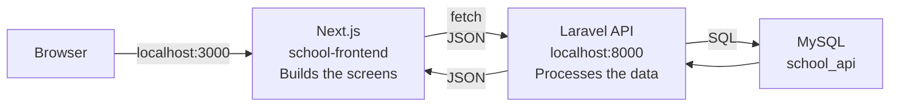
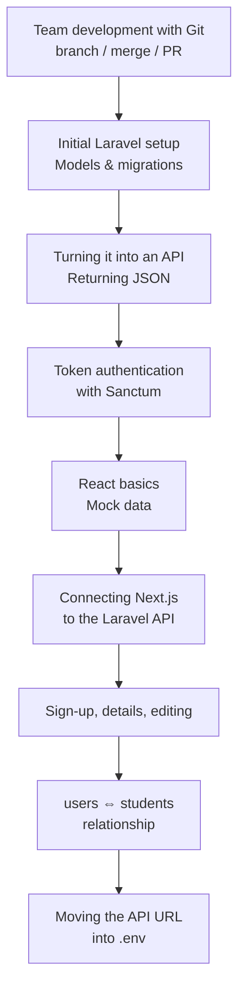
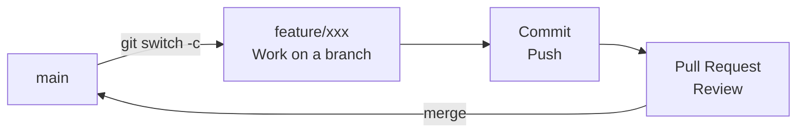
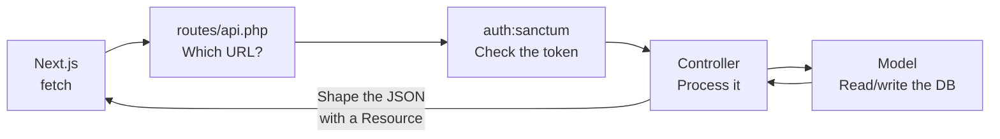
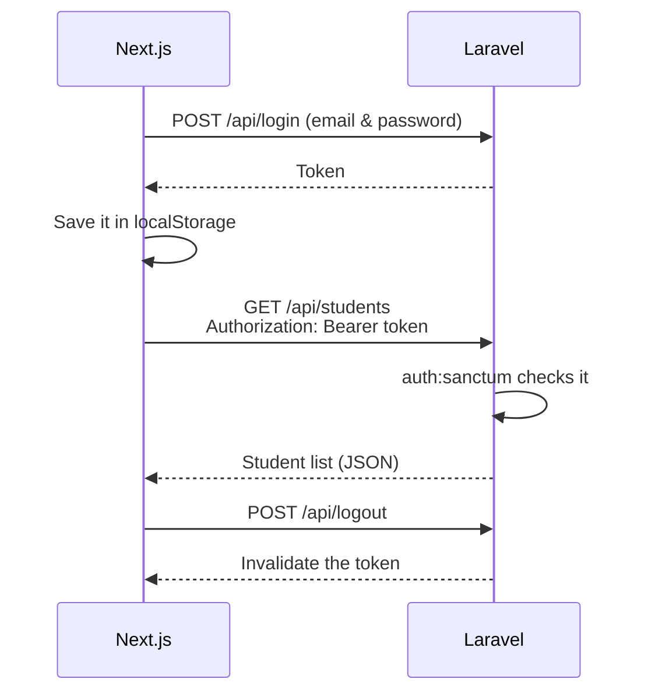
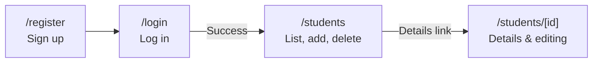
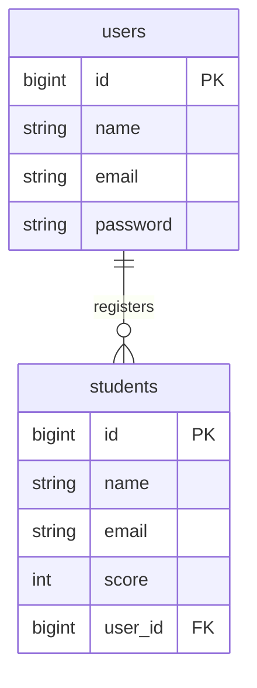
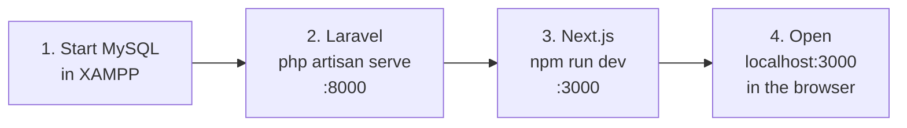

# Looking Back at the First Semester (Review)

> 🇯🇵 Original (Japanese version): [2026_10_02_資料1.md](<../../../2年生_システム開発実践/後期/2026_10_02/2026_10_02_資料1.md>) <!-- original-ja-link -->

Before we start the second semester, let's recall the big picture of the **student management app** we built in the first semester.
In the first semester, we built the screens (frontend) and the data processing (backend) as **separate apps** and connected them with an API.



- **Next.js**: In charge of the screens. When a button is pressed, it sends a request to Laravel
- **Laravel**: Receives the request, reads and writes data in the database, and returns the result as **JSON**
- **MySQL**: In charge of storing the data

---

## 1. How the First Semester Went

In the first semester, we developed the app in the following order.



| Class | Topic | Material |
|----|------|------|
| 4/30 | Team development with Git (branch, merge, Pull Request) | [Material](../../前期/2026_04_30/2026_04_30.md) |
| 5/6 | Initial setup of a Laravel project | [Material](../../前期/2026_05_06/20260506.md) |
| 5/14 | Turning the Blade app into an API | [Material](../../前期/2026_05_14/20260514.md) |
| 5/21 | Resource controllers and token authentication with Sanctum | [Material](../../前期/2026_05_21/20260521.md) |
| 5/28 | Checking token authentication in the browser | [Material](../../前期/2026_05_28/20260528.md) |
| 6/11 | React basics (components, JSX, props, useState) | [Material](../../前期/2026_06_11/2026_06_11.md) |
| 7/2 | Intro to Next.js → connecting to the Laravel API | [Material](../../前期/2026_07_02/2026_07_02.md) |
| 7/9 | New user sign-up + review of tokens, CRUD, and MVC | [Material](../../前期/2026_07_09/2026_07_09.md) |
| 7/16 | Details screen and editing feature | [Material](../../前期/2026_07_16/2026_07_16_実装.md) |
| 7/23 | users ⇔ students relationship | [Material](../../前期/2026_07_23/2026_07_23_実装%20.md) |
| 7/30 | Moving the API URL into .env | [Material](../../前期/2026_07_30/2026_07_30_実装.md) |

---

## 2. Team Development with Git

When we worked on the same repository as a team, we created a **branch** to work on, reviewed the changes in a **Pull Request (PR)**, and then merged them into main (GitHub Flow).



- **Don't touch main directly**: keep it in a working state at all times
- If two people change the same line, a **conflict** happens → open the file, fix it by hand, then commit

---

## 3. Laravel API

### MVC (The Restaurant Analogy)

| Role | Example file | Analogy |
|------|------------|-----------|
| **Model** | `app/Models/Student.php` | Kitchen and fridge (handles the data) |
| **Controller** | `app/Http/Controllers/Api/StudentController.php` | Waiter (takes orders and carries them) |
| **View** | → **Moved to Next.js** when the app became an API | Plating (how it looks) |

By turning it into an API, Laravel no longer builds screens; it now returns **JSON (data only)**.

### The Path a Request Takes



### The API We Built

With just one line, `Route::apiResource('students', ...)`, we got all five CRUD routes at once.

| CRUD | Method | URL | Controller | Auth |
|------|---------|-----|-----------|:----:|
| — | POST | `/api/register` | `AuthController@register` | Not required |
| — | POST | `/api/login` | `AuthController@login` | Not required |
| — | POST | `/api/logout` | `AuthController@logout` | 🔒 |
| Read | GET | `/api/students` | `index` (list) | 🔒 |
| Create | POST | `/api/students` | `store` (add) | 🔒 |
| Read | GET | `/api/students/{id}` | `show` (detail) | 🔒 |
| Update | PUT | `/api/students/{id}` | `update` (update) | 🔒 |
| Delete | DELETE | `/api/students/{id}` | `destroy` (delete) | 🔒 |

The 🔒 routes are inside `auth:sanctum`, so **without a token you get a 401 error**.

---

## 4. Token Authentication

When you log in, Laravel issues a **token** (something like a wristband at an amusement park).
Next.js saves it and shows it every time it calls the API.



When things don't work, check with the browser's **developer tools**.

- `Application` tab → `Local Storage`: is the token saved?
- `Network` tab: does the request include `Authorization: Bearer ...`?

---

## 5. Next.js Screens

The folders inside `app/` correspond directly to **URLs**.



| URL | File | API used |
|-----|---------|--------|
| `/login` | `app/login/page.tsx` | `POST /api/login` |
| `/register` | `app/register/page.tsx` | `POST /api/register` |
| `/students` | `app/students/page.tsx` | List, add, delete, log out |
| `/students/[id]` | `app/students/[id]/page.tsx` + `components/students/StudentDetail.tsx` | View details, update |

If you wrap a folder name in `[ ]` like `[id]`, you can **receive part of the URL as a variable**, as in `/students/1`, `/students/2`, and so on.

Let's also recall the React basics.

| Name | Role |
|------|------|
| **Component** | A part of the screen (`LoginForm`, `StudentList`, etc.) |
| **props** | Passes data from a parent component to a child component |
| **useState** | Holds values that change on the screen (input, list data, etc.) |
| **useEffect** | Calls the API and fetches data, for example when the screen is shown |

---

## 6. Tables and Relationships

So we can tell "who registered" each student, we added `user_id` (a foreign key) to `students`.



- One user can register many students (**one-to-many**)
- If you write `hasMany` / `belongsTo` in the models, you can get the name of the user who registered the student with `$student->user->name`

---

## 7. Two .env Files

Laravel and Next.js each have their **own `.env`**.

| File | What it contains | Example |
|---------|--------------|----|
| Laravel's `.env` | Database connection settings | `DB_DATABASE=school_api` |
| Next.js's `.env` | The API URL | `NEXT_PUBLIC_API_URL=http://127.0.0.1:8000` |

- **Don't put `.env` in Git** (it may contain passwords and similar secrets)
- Instead, share a `.env.example` with the values left empty
- After you change `.env`, **restart the development server**

---

## 8. The Order for Starting the App

The app won't work unless all three are running. Start them in the following order.



Open **two** terminals.

```bash
# Terminal 1: backend
cd Laravel
php artisan serve        # → http://localhost:8000

# Terminal 2: frontend
cd school-frontend
npm run dev              # → http://localhost:3000
```

---

## Review Quiz

Check whether you can explain each of these.

- [ ] What is Next.js in charge of, and what is Laravel in charge of?
- [ ] What's the difference between `GET /api/students` and `POST /api/students`?
- [ ] What comes back if you call `/api/students` without a token?
- [ ] What is the `user_id` in the `students` table for?
- [ ] Why don't we put `.env` in Git? What do we share instead?
- [ ] To run the app, what do you start, and in what order?
