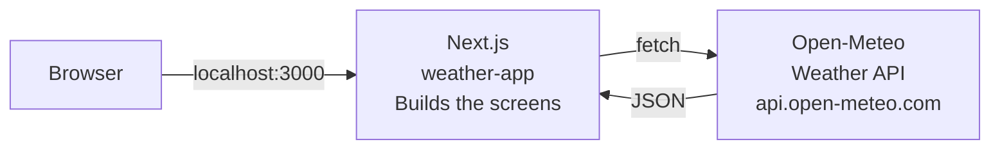
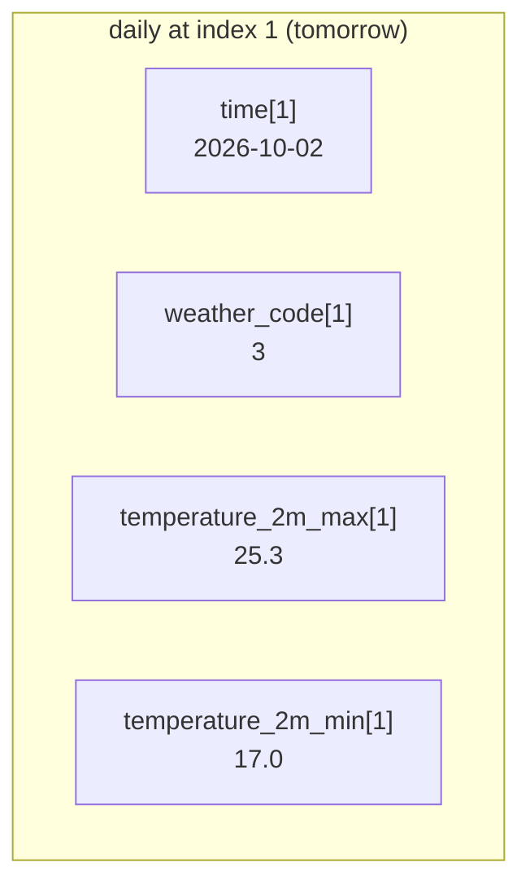
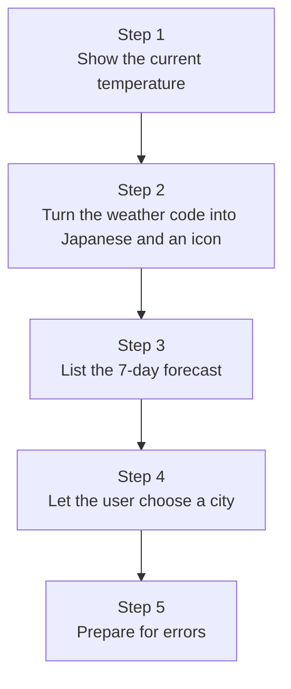
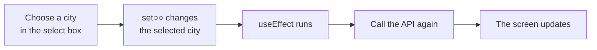

# Advanced Challenge: Build a Weather Forecast App with a Weather API

> 🇯🇵 Original (Japanese version): [2026_10_02_資料2.md](<../../../2年生_システム開発実践/後期/2026_10_02/2026_10_02_資料2.md>) <!-- original-ja-link -->

**If you've finished the student management app**, move on to this challenge.
In the first semester, we received JSON from "a Laravel API we built ourselves" and displayed it on the screen.
This time, we'll receive JSON from a **weather API that is publicly available on the internet (Open-Meteo)** and build a weather forecast app in a **new Next.js project**.



### What the Finished App Looks Like

```
┌─────────────────────────────────────────┐
│ 天気予報（東京）              [ 東京 ▼ ]  │  ← You can choose a city
├─────────────────────────────────────────┤
│        ☀️                                │
│      晴れ   28℃                          │  ← Current weather
│      風速 0.7 km/h                       │
├─────────────────────────────────────────┤
│ 10/1(木)  ☀️ 晴れ    29℃ / 18℃  ☔ 0%    │
│ 10/2(金)  ☁️ くもり  25℃ / 17℃  ☔ 20%   │  ← 7-day forecast
│ 10/3(土)  🌧️ 雨      21℃ / 16℃  ☔ 80%   │
│   …                                     │
└─────────────────────────────────────────┘
```

### Today's Goals

- You can **create a Next.js project from scratch**
- You can call a public **external API** and display the JSON on the screen
- You can **pick out the values you need** from the JSON
- You can **call the API again** when the selected value (city) changes

> **This material does not include the solution code.**
> Use the code from the first semester's student management app (`school-frontend`) as a reference, and try to think it through and write it yourself.

---

## 1. The API We'll Use: Open-Meteo

[Open-Meteo](https://open-meteo.com/) is a free weather API.

- **No sign-up or API key needed** (just open the URL to use it)
- You specify the location by **latitude and longitude**
- You can get **up to 16 days** of forecasts (we'll use 7 days this time)

Let's compare it with the student management app.

| | Student management app | Weather forecast app |
|---|---|---|
| Who built the API | You (Laravel) | Open-Meteo |
| URL | `http://localhost:8000/api/students` | `https://api.open-meteo.com/v1/forecast?...` |
| Authentication | Token required (🔒) | **Not required** |
| Methods used | GET / POST / PUT / DELETE | Only GET (read only) |

> This API is offered for free. **Please don't call it repeatedly by clicking buttons rapidly or making requests in a loop.**

---

## 2. First, Look at the API in the Browser

Before writing code, it's important to check **what kind of JSON comes back**.
Paste the following URL into your browser's address bar and open it (this is the weather for Tokyo).

```
https://api.open-meteo.com/v1/forecast?latitude=35.68&longitude=139.77&current=temperature_2m,weather_code,wind_speed_10m&daily=weather_code,temperature_2m_max,temperature_2m_min,precipitation_probability_max&timezone=Asia%2FTokyo
```

> In Chrome, checking "Pretty-print" makes the JSON easier to read.

### How to Read the URL

The part after `?` contains the **query parameters** (what you're requesting from the API). They're separated by `&`.

| Parameter | Meaning |
|-----------|------|
| `latitude=35.68` | Latitude |
| `longitude=139.77` | Longitude |
| `current=temperature_2m,weather_code,wind_speed_10m` | I want the **current** temperature, weather code, and wind speed |
| `daily=weather_code,temperature_2m_max,...` | I want the **daily** weather code, high temperature, low temperature, and chance of precipitation |
| `timezone=Asia%2FTokyo` | Return the data in Japan time (`%2F` means `/`) |

> If you remove or add items after `current=` or `daily=`, the JSON that comes back changes too. Give it a try.
> You can look up which items are available in the [Open-Meteo documentation](https://open-meteo.com/en/docs).

### Example JSON Response (Excerpt)

```json
{
  "current": {
    "time": "2026-10-01T17:00",
    "temperature_2m": 28.2,
    "weather_code": 0,
    "wind_speed_10m": 0.7
  },
  "daily": {
    "time": ["2026-10-01", "2026-10-02", "2026-10-03", ...],
    "weather_code": [0, 3, 61, ...],
    "temperature_2m_max": [29.1, 25.3, 21.0, ...],
    "temperature_2m_min": [18.2, 17.0, 16.4, ...],
    "precipitation_probability_max": [0, 20, 80, ...]
  }
}
```

### What's Where?

| What you want to show | Where in the JSON? |
|--------------|-------------|
| Current temperature | `current.temperature_2m` |
| Current weather code | `current.weather_code` |
| Current wind speed | `current.wind_speed_10m` (km/h) |
| Dates (7 days) | `daily.time` ← **array** |
| Daily weather code | `daily.weather_code` ← **array** |
| Daily high and low temperatures | `daily.temperature_2m_max`, `daily.temperature_2m_min` ← **arrays** |
| Daily chance of precipitation (%) | `daily.precipitation_probability_max` ← **array** |

Here's the key point.

- `current` holds **a single value**
- `daily` has **an array for each item**, and **entries with the same number (index) belong to the same day**



### Weather Codes (weather_code)

The weather doesn't come back as words like "晴れ" (sunny); it comes back as a **number (WMO code)**.
When you show it on the screen, convert it into Japanese yourself.

| Code | Weather | Example icon |
|-------|------|-----------|
| 0 | 晴れ (sunny) | ☀️ |
| 1, 2 | 晴れ時々くもり (partly cloudy) | 🌤️ |
| 3 | くもり (cloudy) | ☁️ |
| 45, 48 | 霧 (fog) | 🌫️ |
| 51–57 | 霧雨 (drizzle) | 🌦️ |
| 61–67 | 雨 (rain) | 🌧️ |
| 71–77 | 雪 (snow) | ❄️ |
| 80–82 | にわか雨 (rain showers) | 🌦️ |
| 85, 86 | にわか雪 (snow showers) | 🌨️ |
| 95–99 | 雷雨 (thunderstorm) | ⛈️ |

---

## 3. Create a Next.js Project

Create it in a **different folder** from the student management app (`school-frontend`).
Be careful not to create it inside `school-frontend`.

```bash
npx create-next-app@latest weather-app
```

Answer the questions the same way as in the first semester.

```
Would you like to use TypeScript?             → Yes
Would you like to use ESLint?                 → Yes
Would you like to use Tailwind CSS?           → Yes
Would you like your code inside a src/ dir?   → No
Would you like to use App Router?             → Yes
Would you like to use Turbopack?              → No
Would you like to customize the import alias? → No
```

```bash
cd weather-app
npm run dev
```

Open http://localhost:3000. If you see the Next.js sample page, it worked.

### Things to Do Right After Creating It

| File | What to do | Reference |
|---------|---------|------|
| `app/layout.tsx` | Change `lang="en"` to `lang="ja"`, and change `title` to "天気予報アプリ" (Weather Forecast App) | `school-frontend/app/layout.tsx` |
| `app/globals.css` | Delete everything except `@import "tailwindcss";`, and choose the `body` background color and text color yourself | — |
| `app/page.tsx` | Delete all the sample content, and write the weather forecast screen here | — |

> **Why fix globals.css?**
> The initial `globals.css` is set so that **the text turns white** when your computer is in dark mode.
> If you put text on a white card, it becomes invisible, so choose the colors yourself.

> This time, no API key is needed, so you don't need to create a `.env` file.
> Also, since we're not using Laravel, you don't need to start XAMPP or `php artisan serve`.

---

## 4. Build the App Step by Step

Don't try to build everything at once. Move forward **one step at a time, running and checking as you go**.



### Step 1: Show the Current Temperature

**What to do**
- In `app/page.tsx`, call the API when the page is shown, and display Tokyo's **current temperature, weather code, and wind speed**

**Hints**
- Write `"use client";` on the first line (because you'll use `useState` and `useEffect`)
- Use the **`useEffect` and `loadStudents`** pattern in the student management app's `app/students/page.tsx` as a reference; you can follow it almost exactly
- This time, **no token (`Authorization` header) is needed**. Just `fetch` the URL
- At first, you only need `current=` in the URL (you'll add `daily=` in Step 3)
- Before the data arrives, it's empty (`null`), so show "読み込み中..." (Loading...) first
- If you write `useState(null)` in TypeScript, you'll get an error on `weather.current` later → write `useState<any>(null)`

**✅ Check**: The temperature, weather code (a number), and wind speed are displayed

### Step 2: Turn the Weather Code into Japanese and an Icon

**What to do**
- Create a **function** that takes a weather code and returns Japanese text such as "晴れ" (sunny) and an emoji icon
- Display the current weather inside a white card with its **icon, weather, temperature, and wind speed**

**Hints**
- It's a good idea to create the function **outside (above)** `export default function ...`
- Using the weather code table in section 2, check the codes with `if`, starting from the smallest
- To return both the Japanese text and the icon, return an **object** like `{ label: "晴れ", icon: "☀️" }`
- The temperature comes as a decimal like `28.2` → rounding it with `Math.round()` makes it easier to read

**✅ Check**: An icon and Japanese text such as "晴れ" (sunny) are displayed

### Step 3: List the 7-Day Forecast

**What to do**
- Add `daily=...` to the URL and show the 7-day forecast as a list
- On each line, show "date, icon, weather, high temperature, low temperature, chance of precipitation"

**Hints**
- For the list, use `map`, just like the student list. For `key`, use a value that never repeats (the date)
- When you loop over `daily.time` with `map`, the callback's second argument gives you the **index `i`** → `(date, i) => ...`
- Use that `i` to get values from the other arrays with **the same index**, like `daily.weather_code[i]`
- If you want to turn the date `2026-10-02` into the form `10/2(金)`, create `new Date(date)` and use `getMonth()` (it **starts at 0**, so add 1), `getDate()`, and `getDay()` (0 is Sunday)

**✅ Check**: 7 days of forecasts are listed

### Step 4: Let the User Choose a City

**What to do**
- When a city is chosen in a select box, switch to that city's weather and forecast

Use the following table for each city's latitude and longitude.

| City | Latitude | Longitude |
|-----|---------------|----------------|
| 東京 (Tokyo) | 35.68 | 139.77 |
| 大阪 (Osaka) | 34.69 | 135.50 |
| 札幌 (Sapporo) | 43.06 | 141.35 |
| 那覇 (Naha) | 26.21 | 127.68 |

**Hints**
- Keep the list of cities as an **array** of objects like `{ name: "東京", latitude: 35.68, longitude: 139.77 }`
- Store the selected city in state using `useState`
- Replace the `latitude=` and `longitude=` parts of the URL with the selected city's values (template literals `` `...${ }...` `` are handy)
- Remember the `useEffect` dependency array



| How the dependency array is written | When does it run? |
|----------------|----------------|
| `[]` | **Only once**, when the page is shown (we used this for the student list) |
| `[city]` | The first time + **every time city changes** |

**✅ Check**: When you switch cities, the weather and forecast change (try comparing the temperatures in Sapporo and Naha)

### Step 5: Prepare for Errors

**What to do**
- When the API fails, make sure the screen doesn't go blank and an **error message** is displayed instead

**Hints**
- In the student management app, we also checked for failure with `res.ok`
- When you're not connected to the internet, `fetch` itself fails → catch it with `try` / `catch`
- Stop showing "読み込み中" (Loading) whether the request succeeds or fails → `finally`

**✅ Check**: When you deliberately change `latitude=` in the URL to `latitude=999`, an error message is displayed (change it back after checking)

---

## 5. When Things Don't Work

| Symptom | What to check |
|------|-------------|
| `useState is not defined` | Is `"use client";` on the first line, with `import { useState, useEffect } from "react";` below it? |
| `Cannot read properties of null` | You're trying to display the data before it arrives → are you using it **below** the "読み込み中" (Loading) check? |
| `Cannot read properties of undefined` | You're reading the JSON the wrong way / did you forget to add `daily=` to the URL? → compare with the table in section 2 |
| Times or dates are off by 9 hours | Did you add `timezone=Asia%2FTokyo` to the URL? |
| The text is invisible (white) | Did you delete the dark mode settings in `globals.css`? |
| Values are wrong or don't show up | Check the API response (JSON) in the developer tools' `Network` tab |

---

## 6. More Challenges (For Those Who Are Done)

- [ ] **Split into components**: Move "current weather" and "forecast list" into separate files inside `components/`, and pass the data with `props`
- [ ] **Add more cities**: Add your hometown (you can get the latitude and longitude by right-clicking the place in Google Maps)
- [ ] **Search by city name**: Let the user type a city name into an input field to search (the [Geocoding API](https://open-meteo.com/en/docs/geocoding-api) converts a city name → latitude and longitude. No key needed for this one either)
- [ ] **Hourly forecast**: Add `hourly=temperature_2m&forecast_days=1` to the URL and show today's temperature hour by hour
- [ ] **Weather at your current location**: Get your own latitude and longitude with `navigator.geolocation.getCurrentPosition()` and show the weather there
- [ ] **Change the look**: Change the background color depending on the weather (orange for sunny, blue for rain, etc.) / try writing it with Tailwind CSS

> If you still have time, try **creating original weather icons with Gemini** and **deploying to Vercel for free** in [Material 3](./2026_10_02_資料3.md).

---

## Review Quiz

- [ ] What's the difference between the student management app's API and the Open-Meteo API? (who built it, authentication)
- [ ] What does `latitude=35.68&longitude=139.77` after the `?` in the URL represent?
- [ ] Inside `daily`, how do you find the data for the same day?
- [ ] What weather does code `3` represent? How do you display it on the screen as "くもり" (cloudy)?
- [ ] When does `useEffect(() => { ... }, [city])` run?
- [ ] In `try` / `catch` / `finally`, when does `finally` run?
