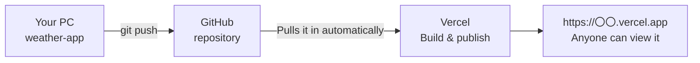
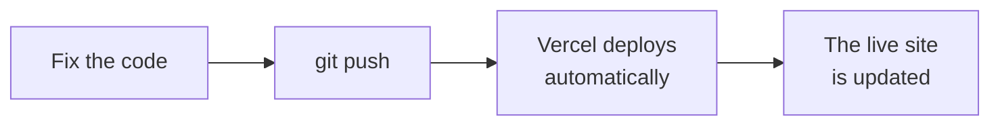

# Advanced Challenge: Power Up Your Weather Forecast App

> 🇯🇵 Original (Japanese version): [2026_10_02_資料3.md](<../../../2年生_システム開発実践/後期/2026_10_02/2026_10_02_資料3.md>) <!-- original-ja-link -->

**If you've finished** the weather forecast app (`weather-app`) from [Material 2](./2026_10_02_資料2.md), continue with this material.

| | What to do |
|---|---|
| 1. | Create original weather icons with Gemini and show them instead of emoji |
| 2. | Deploy to Vercel for free so you can view the app on your phone too |

---

## 1. Create Original Weather Icons with Gemini

Open-Meteo **doesn't send icon images** (all you get back is the weather code number).
So let's **generate images with Gemini**, put them in the `public/` folder, and show them based on the weather code.


### 1-1. Create Images with Gemini

Open [Gemini](https://gemini.google.com/) and ask it to create an image for each type of weather.

| Weather | Example file name |
|-----|-------------|
| Sunny | `sunny.png` |
| Partly cloudy | `partly-cloudy.png` |
| Cloudy | `cloudy.png` |
| Fog | `fog.png` |
| Rain (including drizzle and rain showers) | `rainy.png` |
| Snow | `snowy.png` |
| Thunderstorm | `thunder.png` |

Example prompt (the text of your request):

```
Please create a "sunny" icon for a weather forecast app.
Make it a simple, cute illustration, square, with a white background, and no text.
```

> **Tips**
> - Once the first one is done, follow up with "Please make a 'cloudy' icon **in the same style**" so the art style stays consistent
> - Download the images you get and rename them to the names in the table above
> - Use **ASCII letters and numbers** for file names (avoid Japanese file names)

### 1-2. Put Them in the public Folder

```
weather-app/
└── public/
    └── icons/          ← Create this
        ├── sunny.png
        ├── cloudy.png
        └── ...
```

Files you put in `public/` can be shown with **a path that starts with `/`**.
For example, `public/icons/sunny.png` can be shown with ``.

> First, open http://localhost:3000/icons/sunny.png in your browser and check that the image shows up.

### 1-3. Show Them Based on the Weather Code

**What to do**
- Modify the function you made in Step 2 of Material 2 so that, in addition to the Japanese text and emoji, it also returns an **image path** (such as `/icons/sunny.png`)
- In the current weather and the 7-day forecast, show the image with `` instead of the emoji

**Hints**
- Add an item like `image: "/icons/sunny.png"` to the object you return
- Set the image size using the `width` or `style` attribute of `` (make the images smaller in the forecast list)
- Put Japanese text such as "晴れ" (sunny) in `alt` so users can still tell what the weather is like if the image fails to load

**✅ Check**: When you switch cities, original icons that match the weather are displayed

---

## 2. Deploy to Vercel for Free

Your app is currently at `localhost:3000`, so **only you can see it, on your own computer.**
With [Vercel](https://vercel.com/) (a service from the company that makes Next.js), you can publish it on the internet for free.
Once it's published, you get a URL like `https://weather-app-xxxx.vercel.app`, and **you can view it from your phone or a friend's computer too**.



> **Deploying** means putting the app you built on a server so it can be used from the internet.

### 2-1. Check That It Builds Locally

Vercel runs the same `npm run build`. Check locally first that no errors come up.

```bash
# Stop npm run dev with Ctrl + C first
npm run build
```

- If something like `✓ Compiled successfully` appears at the end and it doesn't stop with an error, you're OK
- If a **red error** appears, fix the file and line mentioned in the message, then run `npm run build` again
- Once you've checked it, you can go back to developing with `npm run dev`

### 2-2. Push to GitHub

A project created with `create-next-app` is **already a Git repository from the start**.

1. Create a **new repository** on GitHub (name it `weather-app`, and **don't add a README or anything else**)
2. Following the commands shown on your new repository's page, connect it with `git remote add origin ...`
3. Push the code so far with `git add` → `git commit` → `git push`

> To review how to use Git, look back at the April 30 material from the first semester.
> Check on the GitHub page that the images in `public/icons/` were pushed too.

### 2-3. Publish on Vercel

1. Open https://vercel.com/, click **Sign Up**, and choose the **Hobby (free)** plan
2. Log in with your GitHub account using **Continue with GitHub**
3. Choose **Add New...** → **Project**
4. Click **Import** next to `weather-app` in the list (if it doesn't appear, allow access to GitHub)
5. **Leave the settings as they are** (Vercel detects Next.js automatically) → click **Deploy**
6. Wait 1–2 minutes. When the celebration screen appears, you're done! Open the URL that's shown

> This time we aren't using an API key, so you don't need to set environment variables in Vercel.

### 2-4. After You Make Fixes, Just Push to Update

Once it's connected, **every time you `git push` to GitHub, Vercel automatically redeploys** for you.



> **Caution**
> - **Anyone can access** the published site using its URL. Don't display personal information such as names on the screen
> - The Hobby plan is **for personal and learning use** (you can't use it for sites that make money)
> - If a deployment fails, the error appears in **Build Logs** on the Vercel screen. Check whether the same error appears with `npm run build` on your own computer

**✅ Check**: You opened the Vercel URL on your phone, and the weather forecast was displayed
