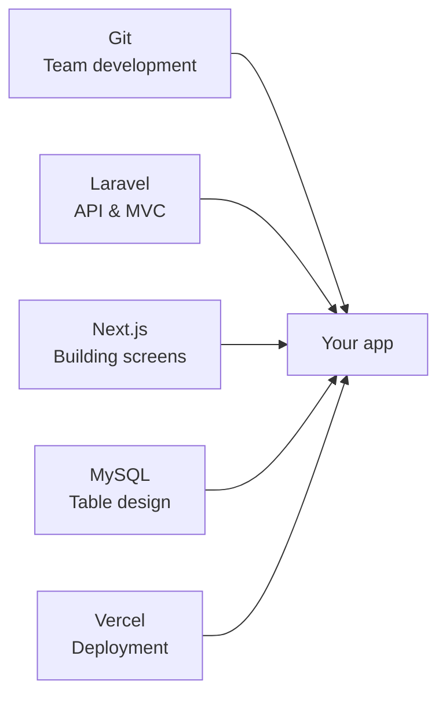
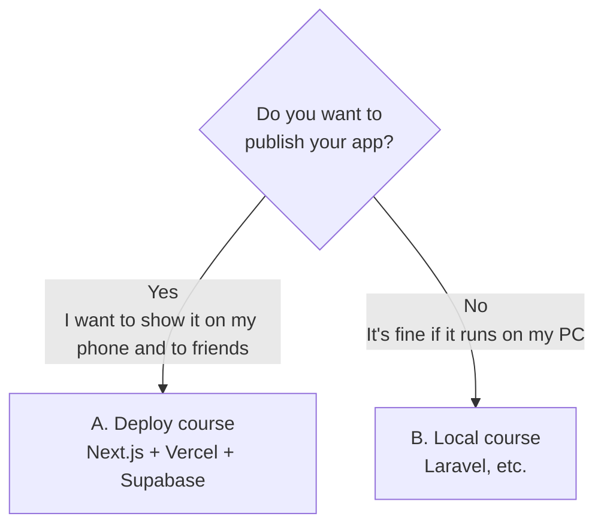
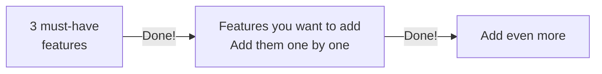
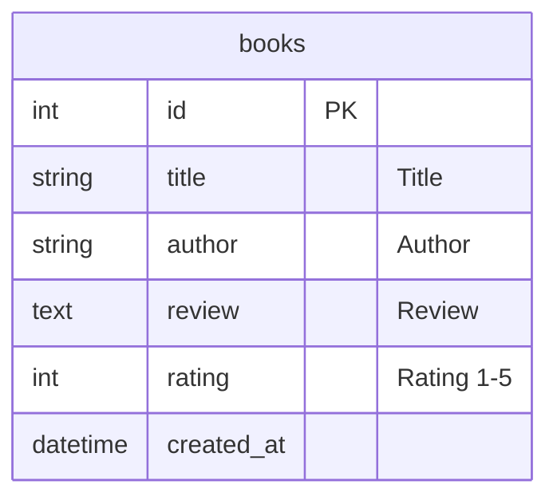
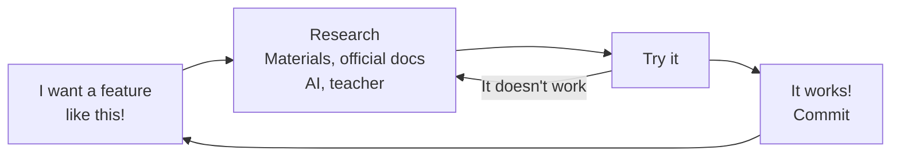
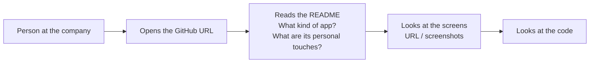
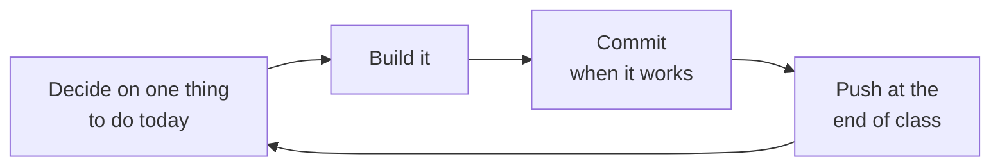

# Independent Project: You've Learned the Basics, So Now Learn by Building What You Want

> 🇯🇵 Original (Japanese version): [2026_10_09_資料1.md](<../../../2年生_システム開発実践/後期/2026_10_09/2026_10_09_資料1.md>) <!-- original-ja-link -->

## Today's Goals
- You can decide what app you want to build
- Aim to make the finished app something you can **submit as a portfolio** in your job search
- You can choose the course that suits you (deploy / local only)
- You can get ready to start development (create a repository and a project)
- You keep two things in mind: "learn while building" and "value your own personal touches"

---

## 1. What Is the Independent Project?

You'll apply what you've learned so far to build **something you like**.
The theme is up to you. Think of an app that would be useful for your hobbies, club activities, part-time job, or everyday life, and make it real.

> 🎯 **Goal: Build an app you can submit to companies as a portfolio in your job search**
> Whichever course you choose, make sure the finished app is something you can **show to companies as "something I developed."**
> For how to submit it, see [5. Submitting It as a Portfolio](#5-submitting-it-as-a-portfolio).



### Why Build Something You Want to Build?

You learned the basics in the classes so far. From here on, it's about **applying** them.
There are three reasons why you'll **decide for yourself what to build and then build it**, instead of doing an assignment the teacher chose.

#### ① When it's something you want to build, it's easier to stay motivated

On the way to finishing an app, you'll run into lots of errors and "I don't get it" moments.
If it's **something you really want**, the feeling of "I want to finish this!" will keep you going until the end.

#### ② In an age when AI can write code, "what you build" is what gets noticed

Today, you can ask AI to write code for you.
That's exactly why **"what you build," "what you're trying to make easier," and "why you built it"** matter.
Companies look not only at whether you can write code, but also at **your ability to find a problem yourself and turn a solution into something real**.

#### ③ You can submit it to companies as a portfolio

You can **submit the finished app to companies as a portfolio** in your job search.
However, if everyone builds similar things, none of them will stick in the minds of the people at the company.
Build **a product that's uniquely yours, one that makes the people at the companies you apply to go "Whoa!"**

### Theme Ideas

| Category | Examples |
|---------|-----|
| Keeping records | Reading log, workout log, household budget, game results log |
| Collecting & showing | Info hub for your favorite idol or character, list of recommended shops, artwork gallery |
| Being useful | Club attendance sheet, assignment deadline tracker, meal-idea roulette |
| Using an API | Weather + outfit advice, Pokémon encyclopedia, movie search |

---

## 2. Choose a Course

Choose a course based on whether **you want to publish your app on the internet**.



| | A. Deploy course | B. Local course |
|---|---|---|
| Material | [Material 2](./2026_10_09_資料2.md) | [Material 3](./2026_10_09_資料3.md) |
| What you use | Next.js + **Vercel** + **Supabase** | Laravel + MySQL (+ Next.js) |
| Where it can be viewed | The internet (`https://〇〇.vercel.app`) | Your own PC (`localhost`) |
| Database | Supabase (a database on the internet) | MySQL (on your own PC) |
| New things to learn | How to use Supabase | Not much (applying what you learned in the first semester) |
| Recommended for | People who want to try new technology too | People who want to really solidify the first semester's content |
| Portfolio submission | **URL** + GitHub | **GitHub** (README & screenshots) |

> Your grade won't change based on which one you choose. **In either course, you can submit your app as a portfolio piece.**
> If you can't decide, talk to your teacher.

---

## 3. Before You Start Building

### Start Small

If you cram in features from the start, you'll end up never finishing.
The trick is to **finish something small first, then add to it later**.



### Think About Your Tables

Using what you learned about table design in the first semester, list the tables and columns you need.



---

## 4. Learn While Building

From here on, instead of the teacher preparing every step for you, **you'll learn as you build what you want to build.**



- Look up what you need when you need it. **You don't have to understand everything before you start building**
- An error isn't a failure; it's **a hint about what to look up next**
- You can look back at the first semester's materials and the completed code at any time

### Key Point: Value Your Own Personal Touches

The most important thing in the independent project is **your own personal touch: "I really want this part to be like this."**

| Examples of personal touches |
|------------|
| I want the screens to match my favorite idol's or character's color |
| I want it to be easy to use one-handed on a phone |
| I want it to be an app I really use every day |
| I want buttons to feel satisfying when you press them |

When you have personal touches,

- you **naturally want to look things up yourself**: "How can I make this work?"
- you **want to show it to people** when it's finished (it can become a portfolio piece)
- you can **explain "why I built this" in your own words** in an interview

Rather than the number of features, focus on **getting your personal touches across**.

---

## 5. Submitting It as a Portfolio

A **portfolio** is work you show companies to say "this is the kind of thing I can build."
In a job search, you may be asked to submit an app you've built with your application form or at an interview.

### What People at the Company Look At

People at the company are busy, so they look at it **for only a short time**. Being "quick to view" and "quick to understand" is important.



### How to Submit for Each Course

| | A. Deploy course | B. Local course |
|---|---|---|
| What to submit | **Public URL** + GitHub URL | GitHub URL |
| How people at the company see the screens | Open the URL and use it right away | See them in the README's **screenshots & videos** |

Apps from the local course can't run on the company's PCs.
So **put screenshots and screen recordings (GIFs) in the README so people can see the app in action**.

### What to Write in the README

In either course, the GitHub `README.md` is the **face** of your app.

```markdown
# App Name


## What kind of app is it?
An app for recording books you've read and your thoughts on them, and viewing them later on a virtual bookshelf.

## What I focused on
- I made the book covers line up so it looks like a bookshelf
- I made the layout easy to read on a phone, too

## Technologies used
- Next.js / Supabase / Vercel

## URL (deploy course only)
https://〇〇.vercel.app
```

- **What I focused on** becomes your answer when you're asked "Why did you build this?" in an interview
- If you write it little by little during development, you won't have to scramble at the end

### Checks Before Submitting

| Check | ✅ |
|---------|---|
| The GitHub repository is set to **Public** | |
| The README has a description of the app, its personal touches, the technologies used, and images of its screens | |
| No API keys or passwords are on GitHub | |
| (Deploy course) The public URL opens and works properly | |

> ⚠️ **If you make it Public, anyone in the world can see it**
> Before submitting, check that it doesn't contain your real name, address, internal school information, and so on.

---

## 6. How to Proceed with Development

In either course, each class follows this flow.



- **Create a repository on GitHub**: create a repository named after your app on your own account
- **Commit often**: save whenever you think "it works up to here"
- **Push at the end of class**: so you can continue on your home PC or another PC
- **Write the README little by little, too**: you can use it as is when you submit your portfolio
- **The 15-minute rule when you're stuck**: if you can't figure it out after 15 minutes of research, ask your teacher or a friend

> ⚠️ **Don't put API keys or passwords on GitHub**
> Write them in `.env` or `.env.local`, and check on the GitHub page that they weren't pushed.

---

## 7. What to Do Today

| What to do | ✅ when done |
|---------|-----------|
| Decide on the app you want to build and your course | |
| Think about your tables | |
| Create a repository on GitHub | |
| Get ready using your chosen course's material ([Material 2](./2026_10_09_資料2.md) / [Material 3](./2026_10_09_資料3.md)) | |
| Make your first push | |
