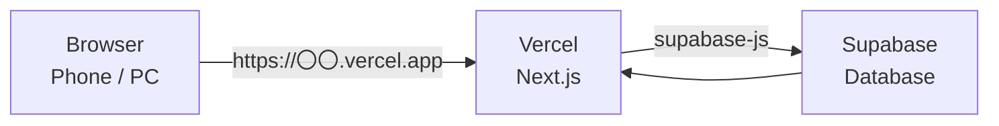
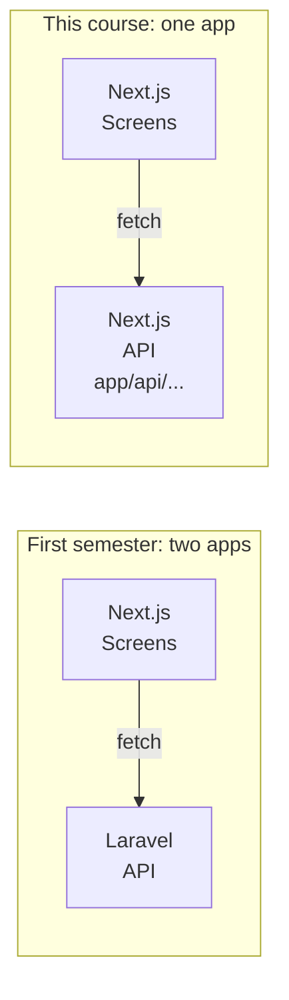
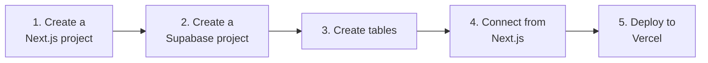
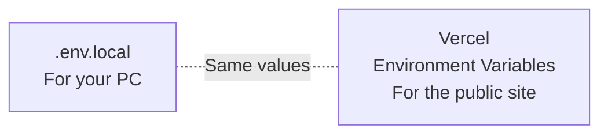

# Independent Project A. Deploy Course — Next.js + Vercel + Supabase

> 🇯🇵 Original (Japanese version): [2026_10_09_資料2.md](<../../../2年生_システム開発実践/後期/2026_10_09/2026_10_09_資料2.md>) <!-- original-ja-link -->

In this course, you'll **publish your app on the internet** so it can be used from your phone or a friend's PC too.

> 💰 **You can build everything for free**
> | Service | Plan to use |
> |---------|----------|
> | Next.js | Free (open source) |
> | Vercel | **Hobby** (free; for personal, non-commercial use) |
> | Supabase | **Free** |
>
> You don't need to register a credit card. Even if you're encouraged to upgrade to a paid plan, don't choose it.

[Back to "Independent Project: Let's Build Something You Like"](./2026_10_09_資料1.md)

---

## 1. How It Works

In the first semester, Laravel handled the data processing and MySQL handled the data storage.
In this course, we'll use **Supabase** in place of both.



| Name | What is it? | In first-semester terms |
|------|-----------|------------|
| **Next.js** | Builds the screens (**it can also build backend APIs**) | school-frontend (+ Laravel API) |
| **Vercel** | Publishes your Next.js app on the internet | (none) |
| **Supabase** | A database on the internet. It also sets up an API for you automatically | Laravel API + MySQL |

### Next.js Is a Full-Stack Framework

In the first semester, we split things into two apps: "screens in Next.js, API in Laravel."
But Next.js is a **full-stack framework**, so **you can build both the screens (frontend) and the API (backend) in a single project.**



If you create a `route.ts` file inside `app/api/`, it defines an API endpoint (this is called a **Route Handler**).

```ts
// app/api/hello/route.ts
export async function GET() {
  return Response.json({ message: "こんにちは" });
}
```

Start the app with `npm run dev` and open http://localhost:3000/api/hello to see the JSON response.

| | First semester (Laravel) | Next.js |
|---|---|---|
| Deciding the URL | Write it in `routes/api.php` | Decided by the **folder location** of `app/api/〇〇/route.ts` |
| Writing the logic | A controller method | Functions such as `GET` / `POST` |
| Returning JSON | `return response()->json([...])` | `return Response.json({...})` |

**When to use Next.js APIs**

- When you use an external API (such as an AI service) and **don't want to expose the API key to the browser**
  (code inside the API runs on the server, so you can safely use environment variables without `NEXT_PUBLIC_`)
- When you want to check data on the server side before saving it

> For simple reading and writing of data, it's fine to connect to Supabase directly from the screens.
> Once you need to do something on the server side, create a Next.js API.

## 2. Setup Steps



### 2-1. Create a Next.js Project

Create it with `create-next-app`, just like the weather forecast app, and push it to GitHub.
→ [Weather forecast app guide](../2026_10_02/2026_10_02_資料2.md)

### 2-2. Create a Supabase Project

1. Open https://supabase.com/, click `Start your project` → **log in with GitHub**
2. Click `New project` and fill it in as follows

| Item | What to enter |
|------|------------|
| Project name | Your app's name |
| Database Password | A strong password (`Generate a password` is fine. Write it down) |
| Region | **Northeast Asia (Tokyo)** |
| Plan | **Free** |

### 2-3. Create Tables

In the left menu, select `Table Editor` → `Create a new table`, then create the tables you planned on your planning sheet.
**Leave** `Enable Row Level Security (RLS)` **turned on** (see the caution below).

### 2-4. Connect from Next.js

In Supabase, go to `Project Settings` → `API Keys` and copy the **Project URL** and the **Publishable key** (or anon key).
In your Next.js project, install the package for using Supabase.

```bash
npm install @supabase/supabase-js
```

Create `.env.local` in the project root and add the values you copied.

```bash
NEXT_PUBLIC_SUPABASE_URL=https://xxxxxxxx.supabase.co
NEXT_PUBLIC_SUPABASE_KEY=the Publishable key you copied
```

Create `lib/supabase.ts` to set up the connection to Supabase.

```ts
import { createClient } from "@supabase/supabase-js";

export const supabase = createClient(
  process.env.NEXT_PUBLIC_SUPABASE_URL!,
  process.env.NEXT_PUBLIC_SUPABASE_KEY!
);
```

After that, you can fetch and add data.

| What you want to do | Supabase | In first-semester Laravel terms |
|------------|---------|----------------------|
| Get everything | `supabase.from("books").select("*")` | `Book::all()` |
| Add | `supabase.from("books").insert({ title: "..." })` | `Book::create([...])` |
| Delete | `supabase.from("books").delete().eq("id", 1)` | `Book::find(1)->delete()` |

> ⚠️ **Watch out for RLS (Row Level Security)**
> For tables with RLS turned on, the data comes back empty unless you create a **policy (a rule about who is allowed to read and write)**.
> Add a policy for each table from `Authentication` → `Policies`.
> When you can't get your data, check here first. If you still can't figure it out, call your teacher.

> ⚠️ **Don't use the `secret` key (service_role key)**
> Anyone can see values that start with `NEXT_PUBLIC_` from the browser.
> Put **only the Publishable key (anon key)** here. If you put the `secret` key here, anyone could change your database.

### 2-5. Deploy to Vercel

Deploy it the same way as the weather forecast app. → [Deploy to Vercel](../2026_10_02/2026_10_02_資料3.md#2-deploy-to-vercel-for-free)

However, this time **you need to set environment variables**.
In your Vercel project, go to `Settings` → `Environment Variables`, register the same two values as in `.env.local`, then redeploy.



> `.env.local` isn't pushed to GitHub (it's listed in `.gitignore`).
> That's why you need to register the values in Vercel separately.

---

## 3. From Here On, Learn While Building

Once you're set up, you'll learn **while building what you want to build**.
As you repeat the cycle of "I want to build this feature → look it up → try it → it works!", you'll learn to use more technologies.

When you're unsure, go back to **your own personal touches**. "I really want this part to be like this" will tell you what to learn next.

When you're done, you can submit the **public URL and GitHub URL** as your portfolio.

> ⚠️ **Supabase pauses if you don't use it for a while**
> On the free plan, **if there's no activity for about a week, the project is paused**.
> While it's paused, no data will show even if you open the public URL.
> You can resume it from the Supabase dashboard to bring it back (your data isn't deleted).
> **Before submitting it or going to an interview, open the public URL yourself and check that it works.**
→ [Submitting It as a Portfolio](./2026_10_09_資料1.md#5-submitting-it-as-a-portfolio)

Also read ["Learn While Building" in Material 1](./2026_10_09_資料1.md#4-learn-while-building).
