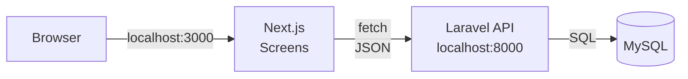
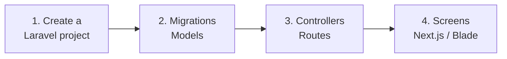

# Independent Project B. Local Course — Laravel, etc.

> 🇯🇵 Original (Japanese version): [2026_10_09_資料3.md](<../../../2年生_システム開発実践/後期/2026_10_09/2026_10_09_資料3.md>) <!-- original-ja-link -->

In this course, your app runs on your own PC (`localhost`).

[Back to "Independent Project: Let's Build Something You Like"](./2026_10_09_資料1.md)

---

You'll use the same technology stack as the **student management app** you built in the first semester. There's not much new to learn, so you can **focus on building features**.

---

## 1. Choose How to Build It

There are two ways to build it.

| Approach | What it is | Recommended for |
|-------|------|---------|
| **Laravel API + Next.js** | Same as the first semester. Use Next.js for the screens and Laravel to handle the data | People who want to review the first semester while building |
| **Laravel only (Blade)** | Build the screens with Laravel's Blade too | People who want to keep the setup simple |

---

## 2. Setup Steps

Use the first semester's materials and the completed code as a reference.

- The overall flow → [Development Flow: Building an API from Scratch](../../前期/開発の流れ_まとめ.md)
- First-semester review → [Looking Back at the First Semester (Review)](../2026_10_02/2026_10_02_資料1.md)
- Completed code → [portfolio](../../前期/portfolio/)

> **The "etc." in "Laravel, etc."**
> If you want to build with something other than what we used in the first semester (such as Python), talk to your teacher.

---

## 3. From Here On, Learn While Building

Once you're set up, you'll learn **while building what you want to build**.
As you repeat the cycle of "I want to build this feature → look it up → try it → it works!", you'll learn to use more technologies.

When you're unsure, go back to **your own personal touches**. "I really want this part to be like this" will tell you what to learn next.

When you're done, you can submit the **GitHub URL** as your portfolio. Put **screenshots and screen recordings** in the README so people can see your app in action.
→ [Submitting It as a Portfolio](./2026_10_09_資料1.md#5-submitting-it-as-a-portfolio)

Also read ["Learn While Building" in Material 1](./2026_10_09_資料1.md#4-learn-while-building).
