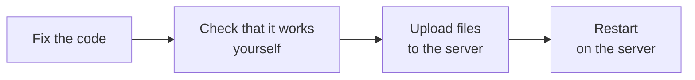
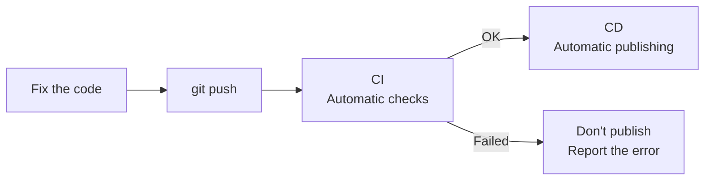
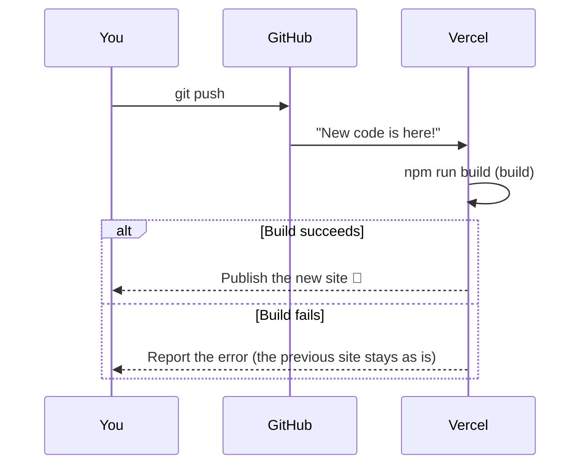
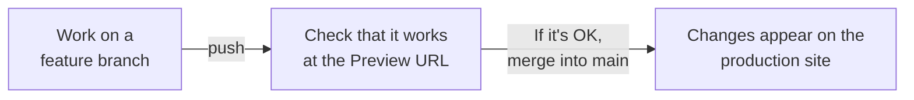
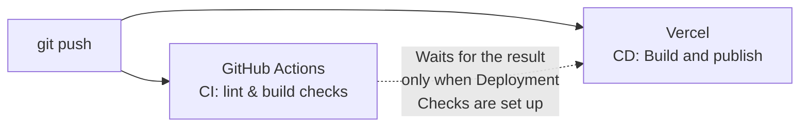

# About CI/CD

> 🇯🇵 Original (Japanese version): [CICDについて.md](<../../../2年生_システム開発実践/後期/2026_10_09/CICDについて.md>) <!-- original-ja-link -->

In the deploy course, your Vercel site was updated just by pushing to GitHub.
That's actually how **CI/CD** works.
Here, we'll look at what CI/CD is.

[Back to Independent Project A. Deploy Course](./2026_10_09_資料2.md)

---

## 1. What Is CI/CD?

**CI/CD** is a way to **automate** "the work that comes after you write code."

| Name | Full name | Meaning | In a word |
|------|----------|------|-----------|
| **CI** | Continuous Integration | **Automatically checks** your code every time you push | Automatic checks |
| **CD** | Continuous Delivery / Deployment | Once the checks pass, **automatically publishes** it | Automatic publishing |

> 💡 **Think of it like "turning in a report"**
> - **CI** = a feature that **automatically checks** for typos and page count before you turn it in
> - **CD** = a feature that **automatically turns it in to the teacher** once the checks pass
>
> When people do this by hand, they may forget to check the report or forget to turn it in. With automation, the same steps are followed every time.

> 📝 **The two meanings of CD**
> CD has two meanings: **Continuous Delivery** (keep the app ready to publish at any time, but a person presses the publish button) and **Continuous Deployment** (everything up to publishing is automatic).
> Automatically publishing when you push, as Vercel does in this material, is **Continuous Deployment**.

---

## 2. What Happens Without CI/CD?

Without CI/CD, every time you fix your code, you do the work **by hand**.



- You forget to check and **publish code with errors**
- You upload **the wrong files**
- You do the same work every time, so **it takes time**

With CI/CD, it looks like this.



**All you do is `git push`.**

---

## 3. Vercel Is Doing CD for You

When you connect Vercel to GitHub, your app is **automatically deployed every time you push**. This is **CD**.



> 📝 **Even if the build fails, your site doesn't break**
> When a build fails, **the previous version of the site remains available**.
> Check the reason for the failure (the error message) on Vercel's `Deployments` screen.

### Each Branch Gets a Preview URL

On Vercel, how your app is published depends on the branch.

| Branch you pushed | What happens? | URL |
|------------------|-----------|-----|
| `main` | The **production site** is updated | `https://〇〇.vercel.app` |
| Any other branch (such as `feature/login`) | A **preview site** is created | `https://〇〇-git-feature-login-〇〇.vercel.app`, etc. |



For new features, if you **create a branch, check it at the Preview URL, and then merge into main**, you won't break the production site.
It's the same **branch → pull request → merge** flow you learned in team development in the first semester.

---

## 4. Let's Try CI (GitHub Actions)

What Vercel does for you is mainly CD.
You can add **CI (automatic checks)** with a GitHub feature called **GitHub Actions** (free for public repositories; for private repositories, it's free up to a set amount of time each month).

### 4-1. Create a Configuration File

Create `.github/workflows/ci.yml` in your project.

```yaml
# .github/workflows/ci.yml
name: CI

# When to run: on push and on pull requests
on:
  push:
  pull_request:

jobs:
  check:
    runs-on: ubuntu-latest   # Runs on a machine provided by GitHub
    steps:
      - uses: actions/checkout@v6      # Get the code
      - uses: actions/setup-node@v6    # Install Node.js
        with:
          node-version: 24
      - run: npm ci                    # Install packages
      - run: npm run lint              # Check the code with a linter
      - run: npm run build             # Check that it builds
```

> ⚠️ **When `npm run lint` doesn't work**
> Projects where you **chose None for the linter** in `create-next-app` don't have a `lint` script. In that case, delete the `npm run lint` line.
> Also, the `next lint` command was removed in Next.js 16. If an older project has `"lint": "next lint"`, change it to `"lint": "eslint"`.
> Look at `"scripts"` in `package.json` to check whether `lint` is there.

| Line | Meaning |
|----|------|
| `on:` | **When** to run |
| `runs-on:` | **Where** to run (borrowing a GitHub machine) |
| `steps:` | **What** to do (run in order from the top) |

### 4-2. Check the Results

When you push the file, you can see the results in the **`Actions`** tab of your GitHub repository.

| Display | Meaning |
|------|------|
| ✅ Green check mark | All the checks passed |
| ❌ Red X | Something failed somewhere → click it to see the error |

The results also appear on the pull request screen, so **you can catch problems before merging**.

> ⚠️ **Even if GitHub Actions fails, Vercel still deploys**
> GitHub Actions (CI) and Vercel (CD) run **separately from each other**.
> So if you don't configure anything, even if CI shows ❌, **the production site is updated** as long as Vercel's build succeeds.
> If you want to "only release to production when CI is ✅," use Vercel's **Deployment Checks** feature.
> In your project's `Settings`, go to Deployment Checks under `Build and Deployment`, click `Add Checks`, and choose the GitHub Actions check (for details, see the [Vercel documentation](https://vercel.com/docs/deployment-checks)).

Here's a diagram of how CI and CD relate.



> 💡 **Adding a badge to your README helps your portfolio stand out**
> Open the workflow in the `Actions` tab, then click `⋮` next to `Filter workflow runs` → `Create status badge` → `Copy status badge Markdown` to get the badge code.
> Adding it to your README shows at a glance that you use CI/CD in your development workflow.

---

## 5. The Benefits of CI/CD

- **You catch mistakes early**: your code is checked right after you push
- **Publishing is easy**: just `git push` and it goes to production
- **The same steps every time**: no more mistakes from manual work
- **Great for team development**: everyone's code is checked by the same rules

In real-world development, CI/CD is **almost always** used.
Using it in your independent project gives you experience you can talk about in your job search.

---

## 6. Summary

- **CI** = **automatically checks** when you push; **CD** = **automatically publishes** once the checks pass
- The only thing Vercel checks automatically is **whether the build succeeds**. If you want GitHub Actions results to block publishing, set up **Deployment Checks**
- Vercel works with GitHub to **automatically deploy every time you push (CD)**
- Branches other than `main` can be checked at a **Preview URL**
- With **GitHub Actions**, you can add **automatic checks (CI)** such as lint and build
- **All you do is `git push`**

[Back to Independent Project A. Deploy Course](./2026_10_09_資料2.md)
