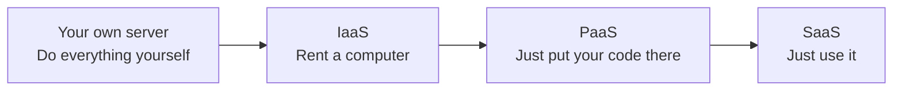
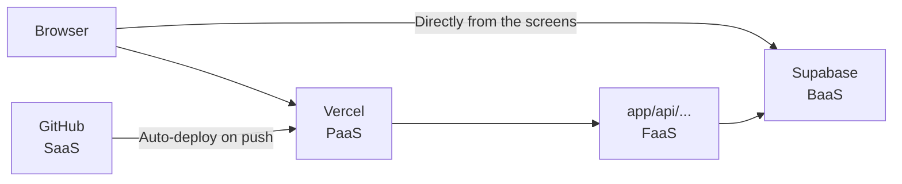

# About IaaS, PaaS, SaaS, and BaaS

> 🇯🇵 Original (Japanese version): [IaaS_PaaS_SaaS_BaaSについて.md](<../../../2年生_システム開発実践/後期/2026_10_09/IaaS_PaaS_SaaS_BaaSについて.md>) <!-- original-ja-link -->

When you look up cloud services, you'll often see terms like **IaaS (pronounced "eye-az")**, **PaaS ("pass")**, **SaaS ("sass")**, and **BaaS ("bass")**.
They're all short for "___ as a Service (using ___ as a service)," and they describe the difference in **how much you leave to the service**.

[Back to Independent Project A. Deploy Course](./2026_10_09_資料2.md)

---

## 1. In a Nutshell

| Name | Full name | What you rent | In a nutshell |
|------|----------|-----------|-----------|
| **IaaS** | Infrastructure as a Service | **The server (computer) itself** | Rent an empty computer |
| **PaaS** | Platform as a Service | **A place to run your app** | Put your code there and it runs |
| **BaaS** | Backend as a Service | **Backend features** | A database and login are ready from the start |
| **FaaS** | Function as a Service | **A place to run functions** | Just write a function and it runs |
| **SaaS** | Software as a Service | **A finished app** | Just use it as is |

The further down the table you go, the **less you have to do yourself**.

---

## 2. The Pizza Analogy

| | What you do yourself | In pizza terms |
|---|---|---|
| **Your own server** | Everything | Make the pizza dough from flour, and buy the oven yourself too |
| **IaaS** | Set up the OS and software, and build the app | Rent a kitchen and oven, and make everything from raw ingredients yourself |
| **PaaS** | Only the app (code) | The dough and oven are ready for you. You just add the toppings |
| **SaaS** | Nothing (you just use it) | Order a delivery pizza and just eat it |

→ The further right you go, the **easier** it gets. The further left you go, the **more freely you can customize**.

---

## 3. Who Manages What?

To run an app, you need several "layers."
**🟦 = you manage it**, **⬜ = the service manages it for you**.

| Layer | Your own server | IaaS | PaaS | SaaS |
|----|:---:|:---:|:---:|:---:|
| App (your code) | 🟦 | 🟦 | 🟦 | ⬜ |
| Data | 🟦 | 🟦 | 🟦 | ⬜ |
| Runtime such as PHP or Node.js | 🟦 | 🟦 | ⬜ | ⬜ |
| OS (Linux, etc.) | 🟦 | 🟦 | ⬜ | ⬜ |
| Server (the machine itself) | 🟦 | ⬜ | ⬜ | ⬜ |
| Network, building, electricity | 🟦 | ⬜ | ⬜ | ⬜ |

---

## 4. A Closer Look at Each One

### 4-1. IaaS — Rent an Empty Computer

Think of it as **renting a computer** that you access over the internet.
Installing the OS, PHP, MySQL, and so on is **up to you**.

- **Examples**: AWS EC2, Google Cloud Compute Engine, Sakura Cloud
- **Pros**: You can do anything you want
- **Cons**: You have to handle all the configuration and security yourself

> If you published the first semester's Laravel app on IaaS, you'd do everything yourself: "install Linux → install PHP and MySQL → put your code there → keep it running 24 hours a day."

### 4-2. PaaS — Put Your Code There and It Runs

This service provides **an environment that is ready to run your app from the start**.
You **just prepare the code**, and it takes care of everything up to publishing.

- **Examples**: **Vercel**, Render, Heroku, Google App Engine
  (Heroku has announced that it will stop developing new features in 2026. Its name still comes up a lot as a long-standing example of a PaaS)
- **Pros**: No server configuration needed. You can publish with just `git push`
- **Cons**: You're limited to the languages and usage patterns the service supports

> 🎯 **Vercel, which we use in the deploy course, is a PaaS.**
> You were able to publish your app on the internet just by pushing your Next.js code to GitHub.

### 4-3. BaaS — The Backend Is Ready from the Start

This service **provides a bundle of backend features such as a database, login, and file storage**.
You can build an app **without writing backend code yourself**, such as the Laravel API you built in the first semester.

- **Examples**: **Supabase**, Firebase
- **Pros**: You can focus on building the frontend (screens)
- **Cons**: For complex processing, you need to build a separate API

| What you want to do | First semester (build it yourself) | Supabase (BaaS) |
|------------|-----------------|-----------------|
| Save data | Laravel API + MySQL | Ready from the start |
| Login feature | Build it yourself | Ready from the start (Authentication) |
| Save images | Build it yourself | Ready from the start (Storage) |

> 🎯 **Supabase, which we use in the deploy course, is a BaaS.**

### 4-4. FaaS — Just Write a Function and It Runs

This service lets you **write a single function that runs only when it's called**.
This is the core idea behind "serverless." → [About Serverless](./サーバレスについて.md)

- **Examples**: **Vercel Functions** (Next.js's `app/api/〇〇/route.ts`), AWS Lambda, Cloudflare Workers
- **Pros**: You pay only for what you use. It scales automatically when traffic increases
- **Cons**: Not good at long-running processes. You can't keep data inside the function

### 4-5. SaaS — Use a Finished App

This service lets you **use a finished app as is over the internet**.
Many of the things you use every day are SaaS.

- **Examples**: Gmail, Google Docs, **GitHub**, Slack, Zoom, Notion
- **Pros**: No installation or management needed. You can start using it right away
- **Cons**: You can't change the app's internals yourself

> If you publish the app you made in your independent project and let others use it, that's **SaaS** too.

---

## 5. Applying This to the Deploy Course Setup

| What we use | Type |
|--------------|------|
| GitHub | SaaS (a finished service for managing code) |
| Vercel | PaaS (a place to run Next.js) |
| Next.js API (`app/api/`) | FaaS (functions that run on Vercel only when called) |
| Supabase | BaaS (a backend with a database, login, and more) |

> 📝 **They can't always be neatly separated**
> A single service can wear several hats, as in "Vercel is a PaaS, and it also provides FaaS."
> Rather than memorizing the names, learn to think about **how much you leave to the service**.

---

## 6. Summary

- "___ as a Service" is about the difference in **how much you leave to the service**
- **IaaS**: Rent a computer (flexible but a lot of work)
- **PaaS**: Put your code there and it runs (Vercel)
- **BaaS**: Backend features are ready from the start (Supabase)
- **FaaS**: Just write a function and it runs (Next.js API on Vercel)
- **SaaS**: Just use a finished app (Gmail, GitHub)
- The more you leave to the service, the **easier** it is; the more you do yourself, the **more freedom** you have

[Back to Independent Project A. Deploy Course](./2026_10_09_資料2.md)
