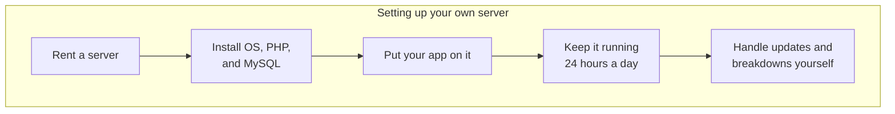
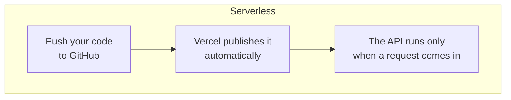
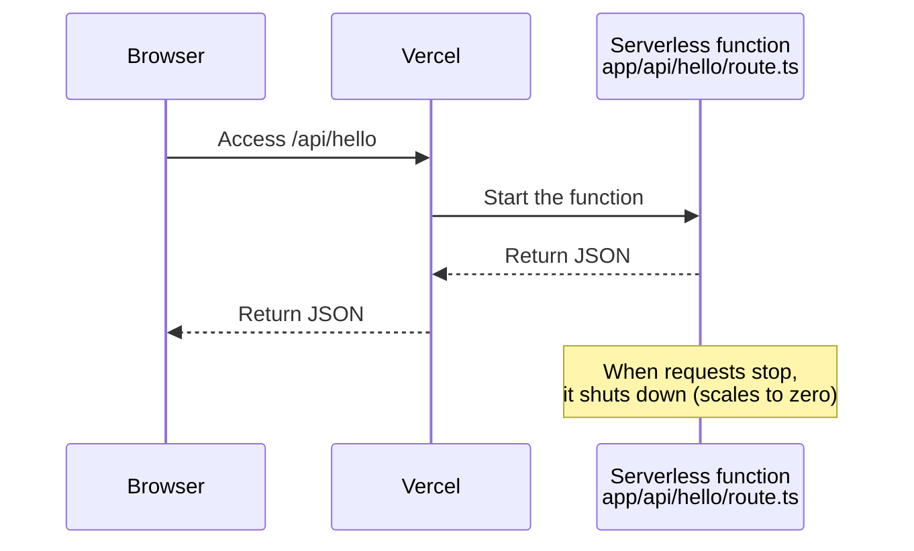
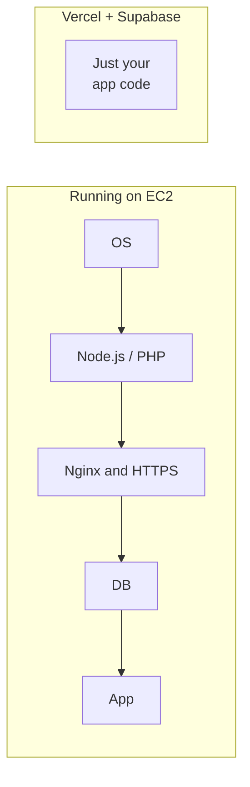

# About Serverless

> 🇯🇵 Original (Japanese version): [サーバレスについて.md](<../../../2年生_システム開発実践/後期/2026_10_09/サーバレスについて.md>) <!-- original-ja-link -->

On **Vercel**, which we use in the Deploy Course, Next.js APIs run using a model called "**serverless**."
On this page, we'll look at what serverless is, comparing it with the Laravel setup from the first semester.

[Back to Free Project A. Deploy Course](./2026_10_09_資料2.md)

---

## 1. What Is Serverless?

**Serverless** does not mean "there is no server."
There **really are** servers. Serverless is a system where **you don't have to set up or manage the servers yourself**.

> 💡 **Think of it like a "taxi"**
> - **Setting up your own server** = buying a car. You handle the parking, inspections, gas, and repairs all by yourself
> - **Serverless** = taking a taxi. You just tell the driver where to go, and the driver (the company) takes care of the car
>
> Either way, you're using a "car." The difference is **who takes care of it**.

---

## 2. Let's Compare It with the First-Semester Approach

In the first semester, you ran `php artisan serve` on your own PC to start the Laravel server.
If you wanted to publish that on the internet, you would need to set up a **server that keeps running all the time** yourself.





| | Setting up your own server | Serverless (Vercel, etc.) |
|---|---|---|
| Setting up the server | You do it (install the OS and software) | **Not needed** |
| Running time | **24 hours a day, all the time** | **Only when a request comes in** |
| When traffic suddenly increases | You add more servers yourself | **Scales up automatically** |
| Updates and security | You do it | The service does it for you |
| Cost | You pay even when it's not being used | **Pay only for what you use** (free for light use) |

---

## 3. What Does "Runs Only When a Request Comes In" Mean?

The biggest feature of serverless is that **it runs only when it's called**.

When you deploy the Next.js API you made in Handout 2 (`app/api/〇〇/route.ts`) to Vercel, it runs as a **serverless function (Vercel Functions)**.



```ts
// app/api/hello/route.ts
export async function GET() {
  return Response.json({ message: "こんにちは" });
}
```

All you write is **this function**.
Vercel takes care of things like "starting the server" and "choosing a port number."

---

## 4. Is Supabase Serverless?

Supabase is the same in that **you don't have to manage the servers**. In the first semester, you ran MySQL on your own PC (with XAMPP or Homebrew), but
with Supabase, **Supabase sets up the database and builds the API for you**.

| Task | First semester (Laravel + MySQL) | Supabase |
|---------|------------------------|----------|
| Running the database | You start it yourself with XAMPP, etc. | Supabase runs it for you |
| Creating tables | Write migrations | Create them in the Table Editor |
| API for reading and writing data | Write controllers and routes yourself | **Provided automatically** |

However, the Supabase database **does not run only when it's called**.
Each project gets its own database server, which **keeps running all the time** (that's why a free-plan project gets paused if it isn't used for about a week).

| | Vercel API (serverless functions) | Supabase database |
|---|---|---|
| Server management | Not needed | Not needed |
| Running time | **Only when called** | **Always running** |
| Type | Serverless (FaaS) | **BaaS** (a service that handles the backend for you) |

> ⚠️ **The free plan has no automatic backups**
> Only paid plans get daily automatic backups from Supabase.
> On the free plan, make sure to export any data you can't afford to lose.

> 📝 **How the word "serverless" is used**
> In the broad sense of "you don't have to manage servers," services like Supabase are sometimes called "serverless" too.
> But that's a bit different from the "runs only when called" kind of serverless in this handout, so remember Supabase as **BaaS**.
> → [About IaaS, PaaS, SaaS, and BaaS](./IaaS_PaaS_SaaS_BaaSについて.md)

---

## 5. Pros and Things to Watch Out For

### Pros 👍

- **You can publish right away**: just push to GitHub to deploy
- **It rarely costs much**: you pay only for what you use. For a student's personal app, the free plan is plenty
- **It can handle more traffic**: the amount it can process increases automatically
- **You can focus on building your app**: you don't have to think about managing servers

### Things to watch out for ⚠️

| Watch out for | What does it mean? |
|---------------|--------------|
| **The first request can be a bit slow** | If the function hasn't been used for a while, it may have stopped, so it takes time to start it again (this is called a **cold start**). Vercel has made cold starts much faster |
| **Not good at long tasks** | Each request has a time limit (**up to 5 minutes** on Vercel's free plan). Not suited for heavy processing |
| **You can't store data inside the function** | You never know when a function will stop, so even if you save something in a variable or file, **there's no guarantee it'll still be there next time** → **store data in Supabase** |
| **The free plan has limits** | If you use too much, it may stop. Don't choose a paid plan |

> 📝 **"Data doesn't stay inside the function" is very important**
> Just like with Laravel, the basic rule is to **store data in the database**.
> Assume that variables inside a serverless function **may be gone** by the next request.
> On the other hand, on Vercel a single function can handle several requests at the same time, so **variables can end up being shared with other people's requests**. Don't put per-user data in variables outside the function.

---

## 6. What If We Didn't Use Serverless? (Running on EC2)

You can really see how helpful serverless is when you compare it with **setting up your own server**.
Here, let's look at running an app on AWS **EC2** (a service where you rent a computer somewhere on the internet).

With EC2, you only rent an **empty computer (Linux)**. Neither Node.js nor PHP is installed.
→ For details, see IaaS in [About IaaS, PaaS, SaaS, and BaaS](./IaaS_PaaS_SaaS_BaaSについて.md).

### 6-1. Running Next.js on EC2

| Task | Details | On Vercel |
|---|---|---|
| 1. Create an EC2 instance | Choose an OS (Ubuntu, etc.) and start it | Not needed |
| 2. Install Node.js | Install Node.js with `nvm` or a similar tool | Not needed |
| 3. Get your code | Run `git clone` | Just connect GitHub |
| 4. Set environment variables | Create a file such as `.env.local` yourself | Register them on a settings screen |
| 5. Build and start | `npm ci` → `npm run build` → `npm run start` | Automatic |
| 6. Keep it running | Use a tool like **PM2** so it doesn't stop when you close the terminal | Automatic |
| 7. Open ports | Open ports 80 and 443 in the EC2 **security group** | Not needed |
| 8. Set up Nginx | Next.js runs on port 3000, so use **Nginx** to forward traffic from ports 80 and 443 | Not needed |
| 9. Enable HTTPS | Get a certificate from **Let's Encrypt** or a similar service, and keep renewing it | Automatic |
| 10. Updating | Log in every time, then `git pull` → build → restart | Just `git push` |
| 11. Ongoing maintenance | OS updates, security measures, and dealing with server outages | Not needed |

### 6-2. Running Laravel on EC2

With Laravel, there's even more to install.

| Task | Details | In the first semester (your own PC) |
|---|---|---|
| 1. Create an EC2 instance | Choose an OS (Ubuntu, etc.) and start it | Your own PC |
| 2. Install PHP | PHP itself plus the extensions Laravel uses (`mbstring`, `xml`, `curl`, `pdo_mysql` for connecting to MySQL, etc.) | XAMPP or Homebrew |
| 3. Install Composer | A tool for managing PHP packages | Installed it |
| 4. Install a web server | Install **Nginx + PHP-FPM** (the system that runs PHP) and configure it to serve the `public/` folder | `php artisan serve` |
| 5. Set up MySQL | Install it on EC2 yourself, or use AWS **RDS** (a database service) | XAMPP or Homebrew |
| 6. Get your code | `git clone` → `composer install --no-dev` | Same |
| 7. Create `.env` | Write `APP_ENV=production`, `APP_DEBUG=false`, the DB connection details, etc., and run `php artisan key:generate` | Same (use production values) |
| 8. Create tables | `php artisan migrate --force` | `php artisan migrate` |
| 9. Set permissions | Allow the web server to write to `storage/` and `bootstrap/cache/` | You didn't have to worry about it |
| 10. Open ports and enable HTTPS | Open ports 80 and 443 and get a certificate from Let's Encrypt | Not needed |
| 11. Updating | `git pull` → `composer install` → `migrate` → rebuild the cache (`php artisan optimize`) | — |
| 12. Ongoing maintenance | OS and PHP updates, security measures, and handling outages | — |

> ⚠️ **Things to watch out for in production**
> - **Don't use `php artisan serve` in production.** It's a simple development server and isn't built to handle lots of traffic. Use Nginx + PHP-FPM instead (which is also why you usually don't need PM2 here, unlike with Next.js).
> - **Never publish with `APP_DEBUG=true` still set.** Important information such as passwords may be shown on the error screen.

### 6-3. Comparing the Two



If you tried to publish the first-semester student management app (Next.js + Laravel API + MySQL) on EC2, you would need **both 6-1 and 6-2**.
The reason we use **Vercel + Supabase** in the Deploy Course is to hand off all this setup and maintenance so we can **focus on building the app**.

> 💡 **Running on EC2 has its value too**
> Doing everything yourself is hard work, but in return you **really understand how servers work**, and you can configure anything you like.
> Servers like EC2 are widely used at real companies. If you're interested, give it a try after the free project.

---

## 7. Summary

- Serverless doesn't mean "no server." It's a system where **you don't have to manage the servers**
- It runs **only when a request comes in**, and you **pay only for what you use**
- A Next.js API deployed to Vercel runs as a **serverless function**
- Supabase also takes management off your hands, but its database is **always running**. It's **BaaS** rather than serverless
- Store data in the **database**, not inside the function
- If you run your app on a server like EC2, you have to **set up and manage everything yourself**: Node.js, PHP, Nginx, HTTPS, the database, and so on

[Back to Free Project A. Deploy Course](./2026_10_09_資料2.md)
