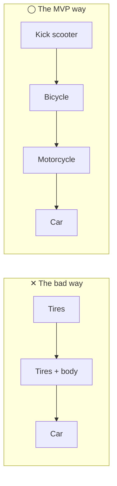
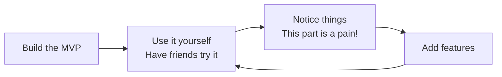
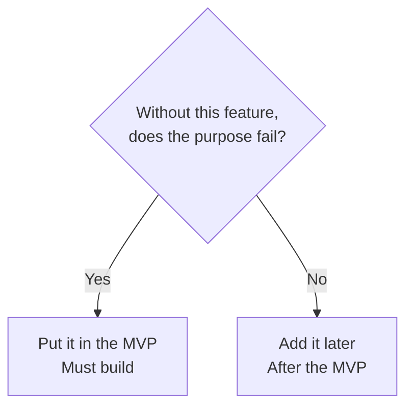
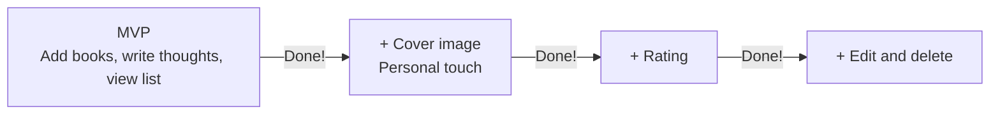
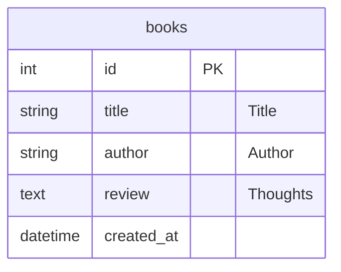

# MVP: First, Finish Something "Minimal but Usable"

> 🇯🇵 Original (Japanese version): [2026_10_16_資料1.md](<../../../2年生_システム開発実践/後期/2026_10_16/2026_10_16_資料1.md>) <!-- original-ja-link -->

## 1. What Is an MVP?

Last time, we talked about how to [start small](../2026_10_09/2026_10_09_資料1.md#start-small).
This "small thing you build" has a name: an **MVP**.

| Full word | Meaning |
|-------|------|
| **M**inimum | The smallest possible |
| **V**iable | Usable; able to work |
| **P**roduct | A product or app |

In other words, an MVP is **an app with the minimum needed to make it usable**
Real companies do the same: when they build a new service, they first build and release an MVP, then grow it while watching how users react.

> 💡 **Think of it like "curry and rice"**
> The MVP of curry is "rice + curry sauce." With just that, **you have a complete curry dish**.
> Pork cutlet, cheese, and pickles are toppings you can add later.
> On the other hand, if you have lots of toppings but **no curry sauce**, you can't eat it as curry.

---

## 2. Common Misunderstandings About MVPs

An MVP is not "something half-finished." What matters is that **even though it's small, it actually works**.



| | ✕ The bad way | ◯ The MVP way |
|---|---|---|
| 1st round | Just tires → **can't move** | Kick scooter → **can move!** |
| 2nd round | Tires + body → **still can't move** | Bicycle → **can move faster** |
| If you run out of time partway | **Nothing usable** | **You still have something usable** |

- With ✕, you **can't use it even once** until you build it all the way to the end
- With ◯, no matter which stage you stop at, **it still achieves the goal of "getting around"**

The same goes for apps. Perfecting only the login screen or the design while **the essential features don't work** is the ✕ pattern.

---

## 3. Why Start with an MVP?

### ① It keeps you from ending up with an unfinished app

The most common failure in the free project is **cramming in too many features and failing to finish the app**.
If you build the MVP first, **you'll have a "working app" no matter when you run out of time**.

### ② Using it early shows you what you really need

The "it'd be nice to have" ideas you think of before building often turn out to be **unnecessary** once you actually use the app.
On the other hand, you may only realize after using the app that some features are essential: "This is inconvenient without them!"



### ③ Your portfolio piece is ready to show early

When you're applying for jobs, **an unfinished app** is hard to present.
Once you have an MVP, you're always **ready to submit it as "something that works."**
Then you can **build the details you care about on top of it little by little**.

---

## 4. How to Define Your MVP

### Step 1: Write the app's purpose in one sentence

First, write in one sentence **"who" the app is for and "what it helps them do."**

```
An app that helps 〇〇 people do △△
```

| App | Purpose (one sentence) |
|-------|-----------|
| Reading log | An app that helps book lovers **record the books they've read and their thoughts, and look back at them** |
| Workout log | An app that helps people who work out **record their daily exercises and reps** |
| Club attendance sheet | An app that helps club managers **keep track of practice attendance** |

> The **bold part** of this sentence is the app's "curry sauce." Without it, the app can't fulfill its purpose.

### Step 2: Write down every feature you want to build

Write down **every** feature you can think of, without holding back. At this point, you don't need to think about whether you can actually build it.

**Example: Reading log app**

- Add a book (title, author)
- Write your thoughts
- Give a rating (1–5 stars)
- See a list of added books
- Edit or delete a book
- Show the cover image
- Search for books
- Group books by genre
- Login feature
- Share books with friends
- Show the number of books read as a graph

### Step 3: Sort them by asking "Would the purpose fail without it?"

Look at each feature one by one and ask yourself: **"Without this, would the purpose (the one sentence from Step 1) fail?"**



**Example: Reading log app** (Purpose: record the books you've read and your thoughts, and look back at them)

| Feature | Does the purpose fail without it? | Category |
|------|-------------------|------|
| Add a book (title, author) | Yes (can't record) | **MVP** |
| Write your thoughts | Yes (can't record thoughts) | **MVP** |
| See a list of added books | Yes (can't look back) | **MVP** |
| Give a rating (1–5 stars) | No (your thoughts are enough to record it) | Later |
| Edit or delete a book | No (you can still record and look back without it) | Later |
| Show the cover image | No | Later |
| Search for books | No (while there are only a few books, the list is enough) | Later |
| Group books by genre | No | Later |
| Login feature | No (not needed if only you use it) | Later |
| Share books with friends | No | Later |
| Show the number of books read as a graph | No | Later |

> 💡 **Aim for about 3 features in your MVP.** If you have 5 or more, ask yourself again: "Would the purpose really fail without it?"

> ⚠️ **Login is often left out of the MVP**
> Login is difficult and takes time, yet in most cases **it isn't the purpose of the app itself**.
> First build something that works without login, and add it later when you need it.

### Step 4: Put the "add later" features in order

Put the "add later" features in **the order you want to build them**.
This is where **the things you care about**, which we talked about last time, really matters.

| Order | Feature | Reason |
|-----|------|------|
| 1 | Show the cover image | **I want it to look like a bookshelf** (the feature I care about most) |
| 2 | Give a rating (1–5 stars) | You can see recommended books at a glance |
| 3 | Edit or delete a book | I want to fix mistakes |
| 4 | Group books by genre | Needed once you have more books |
| … | … | … |



It's a good idea to build the features you care about most **right after the MVP**.
With only the MVP, your app tends to look like everyone else's, but adding your personal touch makes it **"your very own app."**

---

## 5. Thinking About Your MVP Tables

Tables should also start with **only the columns the MVP needs**. You can add columns later with a migration (or the dashboard if you use Supabase).



It's fine to add the rating (`rating`) and the cover image (`image_url`) when you build those features.

