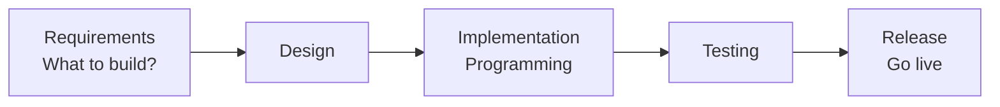
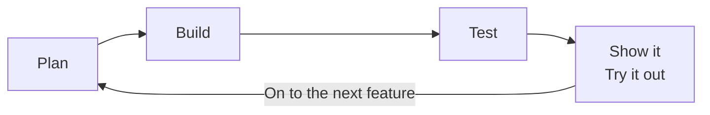
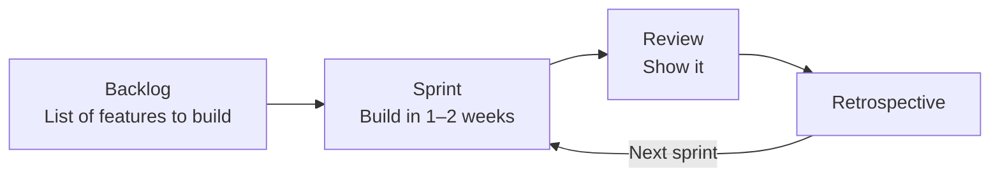

# About Agile Development

> 🇯🇵 Original (Japanese version): [アジャイル開発について.md](<../../../2年生_システム開発実践/後期/2026_10_23/アジャイル開発について.md>) <!-- original-ja-link -->

Last time, we learned about the **MVP**: finishing something small first.
This way of working—"start small, try it out, and improve it little by little"—has a name: **Agile development**.
Here, we'll compare it with the long-established **Waterfall development** approach.

[Back to the Free Project](../2026_10_09/2026_10_09_資料1.md)

---

## 1. In a Nutshell

| Name | Meaning | How it works | In a nutshell |
|------|-------|-------|-----------|
| **Waterfall development** | Waterfall | Decide everything first, then build it in order, all in one pass | Build according to the plan |
| **Agile development** | Agile (quick) | Start small and improve it repeatedly | Develop it gradually as you build |

---

## 2. Waterfall Development

**Like water flowing down a waterfall**, you go through each phase one at a time, in order.
You don't move on to the next phase until the previous one is finished. As a rule, it assumes **you won't go back**.

| Pros 👍 | Things to watch out for ⚠️ |
|------------|-----------------|
| Since everything is decided up front, **the schedule and costs are easy to see** | It's **hard to say** "Actually, I'd like it this way" partway through |
| It's easy to assign different people to each phase | Users only get to see something working **at the very end** |
| Well suited to systems where **mistakes are not allowed**, such as at banks and government offices | If at the end it turns out "this isn't what I expected," **redoing it is a huge job** |

---

## 3. Agile Development

**You repeat "plan → build → check" for each small feature**, growing the app little by little.
Each round is a short period of **about 1 to 4 weeks**.

| Pros 👍 | Things to watch out for ⚠️ |
|------------|-----------------|
| You can see **something working early on** | It's **hard to see at first** how much you'll end up building |
| You can **incorporate user feedback immediately** in the next round | If the approach becomes "just build something for now," **the design can easily become a mess** |
| It's easy to change direction along the way | The team needs to **talk things over frequently** |

> 💡 **The MVP is the "first round" of Agile development**
> Build an MVP, try it out, then add the features you care about one by one—
> that's exactly how the free project works: it's Agile development.

---

## 4. Let's Compare

Let's use **"cooking a meal"** as an example.

| | Waterfall | Agile |
|---|---|---|
| How it works | **Plan the entire** course meal, cook it in order from appetizer to dessert, and **serve it all at the end** | First make one dish, **have someone taste it**, listen to their feedback, and decide what to make next |
| Changes along the way | If someone says "Actually, I'd rather have meat than fish," it's a big problem | Just change it in the next dish |
| Best suited for | A wedding dinner (the menu is decided from the start) | Family meals (they change depending on the mood that day) |

Neither one is "the right one." **You choose depending on what you're building.**

---

## 5. Scrum — One Way to Do Agile Development

The most famous way to do Agile development is **Scrum**. The name comes from the "scrum" in rugby, where a team links arms.

| Term | Meaning | In the free project |
|-----|------|---------------|
| **Sprint** | The period of one round (1 to 4 weeks) | 1 to 2 classes |
| **Product backlog** | A list of the features you want to build, ordered **by importance** | The "features to add later (in build order)" you made in the MVP handout |
| **Daily scrum** | A short meeting of about 15 minutes every day | Deciding "what to do today" at the start of class |
| **Sprint review** | Showing what you've made and getting feedback | Having friends or the teacher try it out |
| **Retrospective** | Looking back on how the work went and using what you learned next time | Thinking about "what went well and what was difficult" at the end of class |

> 💡 **You can make a backlog on GitHub**
> If you create a GitHub **Issue** for each feature you want to build and organize the issues into "To do," "In progress," and "Done" in **Projects**, you can manage a backlog just as teams do in real-world development.

---

## 6. Which One Is More Common in the Real World?

These days, **Agile development** is widely used to build web services and smartphone apps.
That's because they get updated almost every week or even every day, based on how users react.

On the other hand, **Waterfall development** is still used for things like banking systems and systems that control factory machines.
There are also **combinations**, where the big picture is decided with Waterfall and the details are worked out with Agile.

> 💡 **Something you can talk about in interviews**
> If you can say, "In my free project, I first built an MVP, tried it out, and then added features, following an **Agile approach**," it shows you understand the development process.

---

## 7. Summary

- **Waterfall development** = decide everything first, then build it in order, all in one pass (no going back)
- **Agile development** = start small, try it out, and improve it repeatedly
- **Scrum** is one way to do Agile development. You repeat **sprints** (short periods)
- The free project's approach, **MVP → add features**, is Agile development itself
- Neither is "the right one." **Choose depending on what you're building**

[Back to the Free Project](../2026_10_09/2026_10_09_資料1.md)
