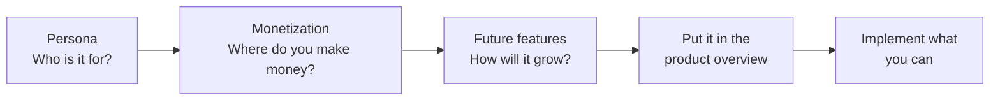
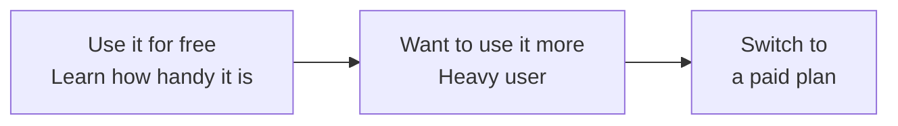
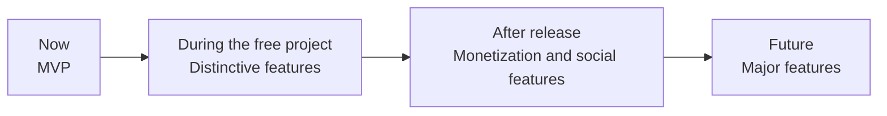
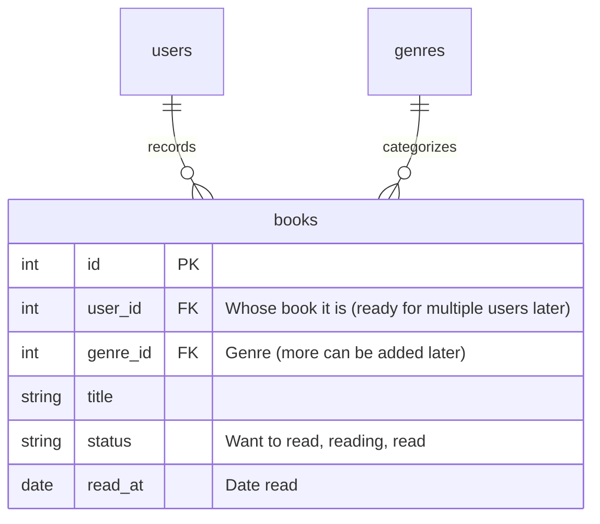
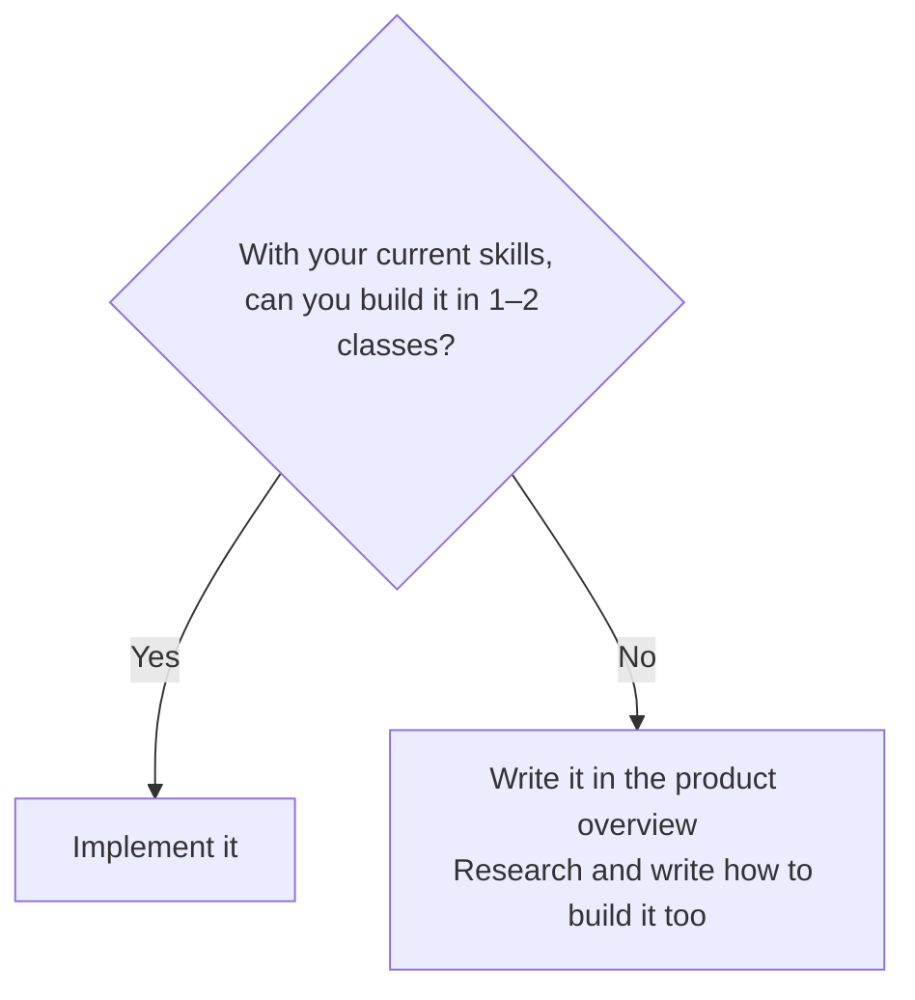

# Build Your Free Project with Its Future in Mind

> 🇯🇵 Original (Japanese version): [自由制作の将来像も考えて作る.md](<../../../2年生_システム開発実践/後期/2026_10_23/自由制作の将来像も考えて作る.md>) <!-- original-ja-link -->

Let's think about your free-project app not as "a class assignment" but as **a service you're really going to release**.
We'll think about **who will use it (persona)**, **where you'll make money (monetization)**, and **what features you'll add from here on**, and put it all together in a **product overview** document.

[Back to the Free Project](../2026_10_09/2026_10_09_資料1.md)

---

## 1. Why Think About the Future?



- **You won't get stuck deciding which features to build**: you can judge by asking "Does this person (the persona) need it?"
- **You can talk about it in interviews**: if you can explain "whose problem the app solves, what problem it is, and how the service will keep going," it shows you're **someone who thinks before building**
- **It's the same as at real companies**: when a company builds an app, it always works out a **plan** before building

> 💡 You don't need to implement everything. Even just **writing your ideas down in the product overview** is valuable for your portfolio.

---

## 2. Setting Up a Persona

### What is a persona?

A **persona** is a detailed description of the person who uses your app, imagined as **one specific person**.
Instead of a rough grouping like "people in their 20s," you picture **one person who could actually exist**.

| ✕ Rough | ◯ Persona |
|----------|----------|
| People who like books | Sakura Tanaka (21, third-year university student). Reads 3–4 books a month on the train to school. Her problem is that she quickly forgets what the books she read were about, and can't answer when friends ask her for recommendations |

> 💡 **Why narrow it down to one person?**
> When you build something "for everyone," it tends to become an app that's **a little hard to use** for anyone.
> When you narrow it down to one person, you can **think concretely**, like "Sakura would want to record things **with one hand** on the train."

### What to decide for your persona

| Item | Example (reading log app) |
|-----|-----------------|
| Name, age, occupation | Sakura Tanaka, 21, third-year university student |
| Daily life | Reads for 30 minutes every day on the train to school. Always has her smartphone with her |
| Comfort with IT | Uses social media a lot. Not good with complicated settings |
| Problem | Quickly forgets what the books she read were about. Can't answer when asked for recommendations |
| Goal (what does she want?) | Wants to be able to quickly look back at the books she's read and her thoughts on them |
| When she uses the app | Records a book **on her smartphone** right after finishing it on the train |

> ⚠️ **Don't make the persona someone who's convenient for you**
> Hardly anyone "opens the app every day and uses every single feature."
> Think of a realistic person, someone who's **busy, a bit lazy, and gets bored quickly**.

---

## 3. Deciding What to Charge For

### Ways to make money (revenue models)

| Model | How it works | Examples |
|-------|------|-----|
| **Ads** | The app is free. You show ads on the screen and get money from advertisers | YouTube (free plan), news apps |
| **One-time purchase** | Users pay only once, at the start | Paid smartphone games, software |
| **Subscription** | Users pay every month or every year | Netflix, Spotify |
| **Freemium** | The basics are **free**. Only people who want more convenient features **pay** | Spotify, Notion, LINE stickers |

For a web app you build on your own, **freemium** is the easiest revenue model to plan around.

### Drawing the line between "free" and "paid"

The most important thing in freemium is **how much is free and where paid features start**.



| Idea | Explanation |
|-------|------|
| **Keep the app's core functionality free** | If the MVP features (the most important features) cost money, nobody will start using the app |
| **Charge the people who use it most** | Draw the line with a **usage limit**, like "free up to 〇 items" |
| **Charge for features that are useful but not essential** | Easy-to-read graphs, data export, design changes, etc. |
| **Think about why the persona would pay** | "What would Sakura pay 300 yen a month for?" |

**Example: Reading log app**

| | Free plan | Paid plan (300 yen/month) |
|---|---|---|
| Adding books | **Up to 50 books** | Unlimited |
| Writing thoughts | ◯ | ◯ |
| Looking back at the list | ◯ | ◯ |
| Graph of books read | ✕ | ◯ |
| Bookshelf design changes | 1 design | 10 designs |
| Ads | Yes | **None** |

> 💡 **Thinking about it from "Sakura's" point of view**
> She's a student, so she can't pay much. But after a year, by the time she **goes past 50 books**, she'll have built up so many records that she won't want to give them up.
> If you offer "unlimited + graphs" for 300 yen a month at that moment, she just might pay.

---

## 4. Thinking About Future Features

### Sorting features by timing

In the [MVP](../2026_10_16/2026_10_16_資料1.md) handout, you wrote down "features to add later." Now, sort and arrange them by **timing**.
This plan of "when to build what" is called a **roadmap**.



| Timing | Example features (reading log app) |
|-----|-----------------------|
| **Now (MVP)** | Adding books, thoughts, list |
| **During the free project** | Cover images, ratings (stars), search |
| **After release** | Login, paid plan, graph of books read |
| **Future** | Sharing bookshelves with friends, adding books by scanning barcodes, AI book recommendations |

### How to come up with ideas

- Picture **a day in the persona's life**, and look for moments where "it'd be handy if I could use it here too"
- Try out **3 similar apps** and write down what works well and what's inconvenient about each one
- Think about what you could do **once data builds up** (graphs, rankings, recommendations)
- Think about what you could do **if users could connect with others** (sharing, comments, rankings)

---

## 5. Good Design Thinks About the Future Too

### "Predicting" features nobody has asked for

When you build an app for work, a client will ask you, "Please build an app like this."
But the client **won't tell you everything they need**. It's common for them to come back after they start using it and say, "Actually, we'd like this too."

**Good design** doesn't mean building only what you're told.
It means **predicting, "They haven't said it, but they'll probably ask for a feature like this," and designing with that in mind**.

> 💡 **Think of it like "building a house"**
> When building a house for a couple, you might think, "They'll probably want another room if they have a child someday," and
> make one large room that **can be split into two rooms later by adding a wall**—that's design that thinks about the future.
> You don't build the child's room right now, but you make it **easy to add later**.

### Prediction examples (reading log app)

| What's being asked for now | What they might ask for (prediction) | Design to put in place now |
|------------------|--------------------|-------------------|
| I want to record the books I've read | "I want my family and friends to use it too" | Set up the `books` table so it can hold a `user_id` showing whose book it is |
| I want to record "read" | "I also want to distinguish **books I want to read** and **books I'm reading**" | Instead of a two-choice "read / not read" (`true` / `false`), use a **status (`status`)** column |
| I want to add genres | "I want to add my own genres and rename them" | Instead of writing the genre directly as text, **store genres in a separate `genres` table** and link to it |
| I want to write my thoughts | "I want to **rewrite** my thoughts later" "I want to know when I read it" | Keep `created_at` and `updated_at`, and plan for a **date-read (`read_at`)** column |



> ⚠️ **It doesn't mean "building every feature you predict"**
> What you think about for the future is the **design (the shape of the tables and how the code is split up)**. The features themselves should be built small and added little by little, as in the [MVP](../2026_10_16/2026_10_16_資料1.md) handout.
> If you start building everything "they might ask for," you'll never finish.
> **Don't build it now. But shape things so you won't have to rebuild when you add it later**—that's the key point.

### Hints for making predictions

- **One person → many people**: it's used by one person now, but might someone say, "I want other people to use it too"?
- **Two choices → three or more**: you built it as "yes / no," but might someone say, "I want one more option"?
- **Fixed values → user-editable**: for options written in the program, might a user say, "I want to add or change these options myself"?
- **Just now → keep a history**: might someone say they want to know "when it changed" or "what it used to be"?
- Think in terms of your **persona**: "After Sakura uses it for six months, what will she want next?"

> 💡 **Something you can talk about in interviews**
> If you can say, "There's no login feature yet, but I designed the tables so they can hold a `user_id`, so other people can use the app in the future,"
> it shows you're **someone who can design with the future in mind**. Also write your predictions in the roadmap in your product overview.

---

## 6. Implement It, or Write It in the Product Overview?

You don't have to build every feature you think of.
Sort them like this: **if it isn't difficult, implement it**; **if it looks difficult, write it in the product overview**.



| Guideline | Examples |
|-----------|-----|
| **Implement it** (you can do it by applying what you already know) | Adding a column (rating, genre), search, sorting, a "up to 〇 items" limit check, **just the screen** for the paid plan (a pricing page) |
| **Write it in the product overview** (involves new technology, money, or personal information) | Real payments (credit cards), barcode scanning, AI recommendations, turning it into a smartphone app, a system that many people can use at the same time |

> 💡 **"Writing it in the product overview" is a real achievement too**
> If you **research and write down how to build it**, like "Payments could probably be implemented using a service called **Stripe**,"
> you can say in an interview, "I can't build it yet, but I know how to."

> ⚠️ **Don't implement real payments**
> With credit card payments, a mistake means **real money actually moves**. In the free project, stop at **writing it in the product overview**.
> If you want to try out how monetization works, go only as far as **switching a user's paid-plan status on and off using a database column (such as `is_premium`)**.

---

## 7. Creating the Product Overview

Put your ideas together in a **product overview** document.
A product overview explains "**what the product is, who it's for, and how it will grow from here**" in a way that even someone seeing it for the first time can understand.
If you create `docs/プロダクト概要.md` in your repository and write it there, you can show it directly on GitHub. Link to it from your README.

### Product overview template

```markdown
# 〇〇 (App Name) Product Overview

## 1. In a Nutshell
An app that helps 〇〇 people do △△

## 2. Persona
- Name, age, occupation:
- Daily life:
- Comfort with IT:
- Problem:
- Goal (what do they want?):
- When they use the app:

## 3. How It Differs from Similar Apps
| App | Strengths | Drawbacks |
|-------|----------|-----------|
|       |          |           |

What makes this app distinctive:

## 4. Revenue Model (What to Charge For)
- Model: (Freemium / Ads / Subscription / One-time purchase)
- Paid plan price:

| | Free plan | Paid plan |
|---|---|---|
|   |   |   |

Why the persona would pay:

## 5. Roadmap (Future Features)
| Timing | Feature | Status |
|-----|------|-----|
| Now (MVP) |  | ✅ Implemented |
| During the free project |  | 🚧 In progress |
| After release |  | 📝 Not built yet |
| Future |  | 📝 Not built yet |

## 6. Notes on How to Build Features Not Yet Implemented
- 〇〇 feature: could probably be done using the △△ service/technology
```

### Tips for writing it

- Make sure the **persona → monetization → roadmap** are all **connected** (the features the persona wants appear in the paid plan or the roadmap)
- Use the status column (✅ 🚧 📝) so you can see **how much has been implemented** at a glance
- Don't write it once and stop. **Update it often** as you build (the same idea as [Agile development](./アジャイル開発について.md))

---

## 8. Summary

- Think about your free-project app as **a service you're really going to release**
- **Persona** = define the person who uses the app as **one specific person**
- For monetization, **freemium** is an easy model to plan around. **Keep core features free**, and **charge heavy users and for nice-to-have features**
- **Sort future features by timing** into a roadmap
- **Good design** **predicts** features the client hasn't asked for and keeps things in a shape that's **easy to add to later** (but builds them little by little)
- **If it isn't difficult, implement it**; **if it is difficult, write it in the product overview** (and research how to build it too)
- Don't implement real payments. For monetization, go only as far as **switching a user's paid-plan status with a database column**
- Write the product overview in `docs/プロダクト概要.md` and link to it from your README

[Back to the Free Project](../2026_10_09/2026_10_09_資料1.md)
