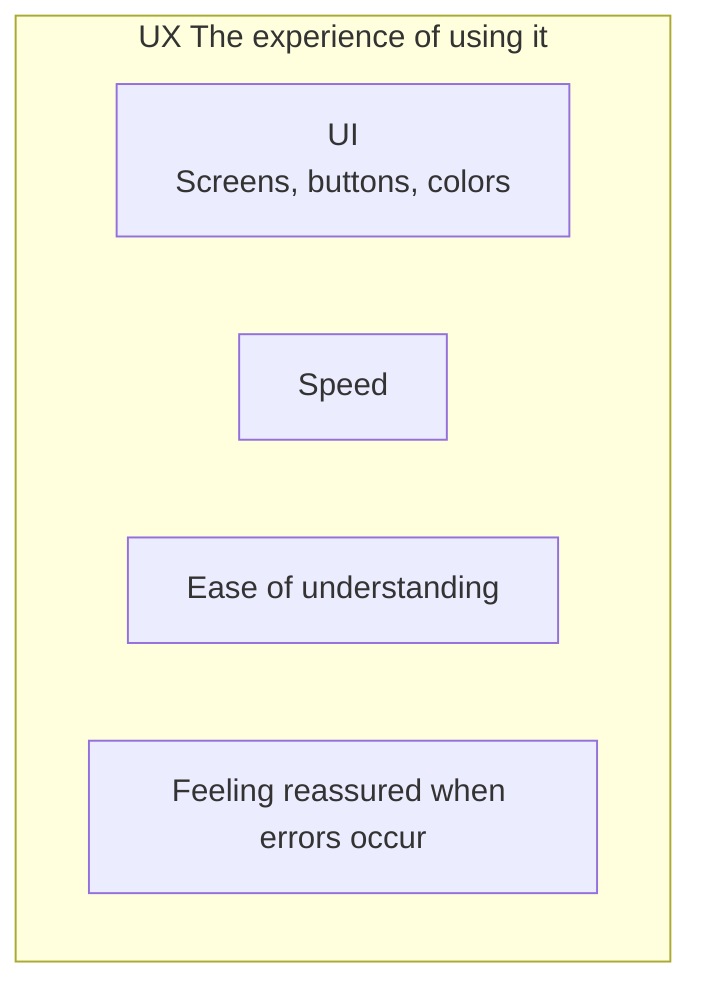
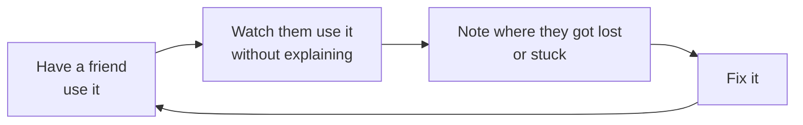

# About UI and UX

> 🇯🇵 Original (Japanese version): [UI_UXについて.md](<../../../2年生_システム開発実践/後期/2026_10_30/UI_UXについて.md>) <!-- original-ja-link -->

When people talk about apps, the terms **UI** and **UX** come up a lot.
Both are about "the people who use the app," but their meanings are a little different.

[Back to the Free Project](../2026_10_09/2026_10_09_資料1.md)

---

## 1. In a Nutshell

| Name | Full name | Meaning | In a nutshell |
|------|----------|------|-----------|
| **UI** | User Interface | The parts users **see and touch** (screens, buttons, text, colors) | Look and controls |
| **UX** | User Experience | How users **feel about using it** (whether it's convenient, enjoyable, and easy to understand) | The experience of using it |

> 💡 **Think of it like a "restaurant"**
> - **UI** = the menu, the plates, the tables, the interior of the restaurant
> - **UX** = the **whole experience**: "I got a seat right away," "it was easy to order," "the food was delicious," and "I want to come back"
>
> Even if the menu is stylish (good UI), if the food takes an hour to come out, the experience (UX) isn't good.

---

## 2. How UI and UX Are Related

UI is **part of** UX.
To create a good UX, you need a good UI, but **a good UI alone doesn't make the UX good**.

| Example | UI | UX |
|----|----|----|
| The button looks cool, but nothing happens when you press it | ◯ | ✕ |
| It looks plain, but you can quickly get to the information you want | △ | ◯ |
| All the data you entered disappeared because of an error | — | ✕✕ |

---

## 3. Tips for Good UI

### ① Keep things consistent (consistency)

Things that mean the same thing should have **the same look and the same position**.

| ✕ Bad | ◯ Good |
|----------|-------|
| The "Save" button's color and position change from page to page | The Save button has **the same color and position** on every page |
| Different words are used for the same meaning: "Register," "Add," "Create" | **Stick to one word** |

### ② Make clickable things look clickable

Buttons and links should look **clickable at a glance**.
Changing the color when the mouse is over them (`hover`) makes this even clearer.

### ③ Make important things stand out

Give the button you most want users to press (such as "Save") a **dark color**, and give the others (such as "Cancel") a **light color**.
If everything stands out, **nothing stands out**.

### ④ Make it easy to read

- Use strong **contrast** between text and background colors (light gray text is hard to read)
- Don't make text too small
- Leave white space (gaps) and don't cram things in

---

## 4. Tips for Good UX

### ① Provide feedback

When a button is pressed, **let users know what happened**. Without a response, users wonder, "Did that work?" and end up pressing it again and again.

| Situation | Feedback example |
|-----|----------------|
| Saving | Show "Saving…" and disable the button |
| Saved | Show "Saved" |
| Error | Show **what went wrong and what to do about it** |

### ② Make errors friendly

| ✕ Bad | ◯ Good |
|----------|-------|
| `Error 422` | "Please enter a title" |
| When an error happens, everything you entered disappears | **Keep** what was entered, and highlight the field with the error in red |

### ③ Ask for confirmation before things that can't be undone

For actions that can't be undone, like **deleting**, ask for confirmation: "Are you sure you want to delete this?"

### ④ Finish in just a few steps

The more often a feature is used, the **fewer clicks** it should take.
People will gradually stop using an app if they have to go through 3 pages every time they record something.

---

## 5. How to Check Your Own App

The best way is to **have other people use it**.

- Because you built it and already know how to use it, **you won't notice the confusing parts**
- The places where the user **gets stuck or lost** are the places you need to fix
- If you feel like explaining it out loud, that's a sign that **the screen isn't getting the message across**

---

## 6. Summary

- **UI** = the parts users **see and touch**, like screens, buttons, and colors
- **UX** = **what users feel and the whole experience** when using it
- UI is part of UX. **Good looks alone don't make a good experience**
- Good UI: **keep things consistent, make clickable things look clickable, make important things stand out, make it easy to read**
- Good UX: **provide feedback, make errors friendly, confirm actions that can't be undone, keep steps to a minimum**
- The best way to check is to **have other people use it**

[Back to the Free Project](../2026_10_09/2026_10_09_資料1.md)
