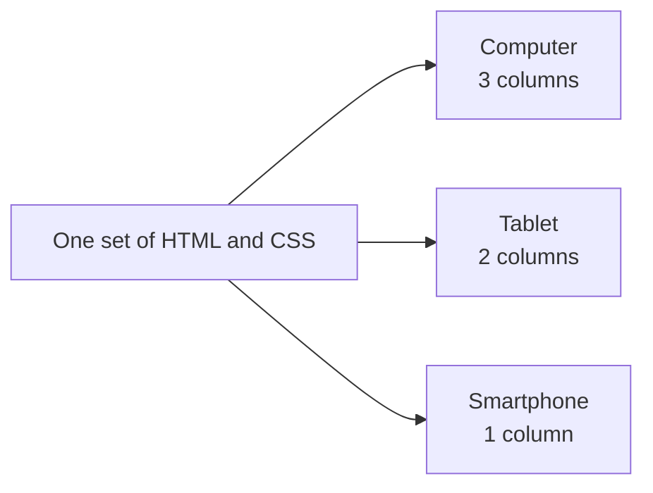
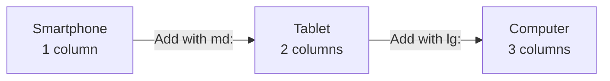
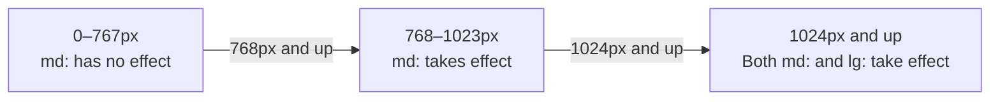
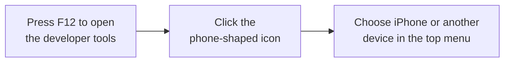

# About Responsive Design

> 🇯🇵 Original (Japanese version): [レスポンシブデザインについて.md](<../../../2年生_システム開発実践/後期/2026_11_06/レスポンシブデザインについて.md>) <!-- original-ja-link -->

Websites are viewed on **screens of many different sizes**, on computers, tablets, smartphones, and more.
Building a single page so that it **displays nicely on any screen** is called **responsive design**.

[Back to the Free Project](../2026_10_09/2026_10_09_資料1.md)

---

## 1. What Is Responsive Design?

**Responsive** means "reacting."
The layout reacts to the **width** of the screen and switches automatically.



> 💡 **In the past, people built separate "mobile sites"**
> In the past, people sometimes built a page for computers and a page for smartphones (like `m.〇〇.com`) **separately**.
> That meant every time you fixed something, you had to **fix both**. With responsive design, **you only fix one**.

---

## 2. Why Is It Important?

- Today, **a lot of people view websites on smartphones**
- People at companies might also **open your portfolio URL on a smartphone**
- If the text is too small or content overflows horizontally on a smartphone, **that alone can leave a poor impression**

---

## 3. How It Works ①: The Viewport

If you don't specify anything, smartphone browsers display **a scaled-down version of the desktop page** (the text becomes very small).
What prevents this is the **viewport** setting you write in the HTML `<head>`.

```html
<meta name="viewport" content="width=device-width, initial-scale=1">
```

| Part | Meaning |
|-----|------|
| `width=device-width` | Match the page width to **the screen width of the device** |
| `initial-scale=1` | Display the page **without zooming in or out** at first (at a scale of 1) |

> 📝 **Next.js adds it automatically**
> In Next.js (App Router), this viewport setting is **included automatically from the start**.
> When you build with Laravel Blade, write it yourself in your layout file (pages created with `laravel new` already include it).

---

## 4. How It Works ②: Media Queries

A **media query** is a way of saying "use this CSS only when the screen width is a certain number of px or more."

```css
/* By default (smartphones), 1 column */
.cards {
  display: grid;
  grid-template-columns: 1fr;
}

/* If the screen width is 768px or more, 2 columns */
@media (min-width: 768px) {
  .cards {
    grid-template-columns: 1fr 1fr;
  }
}

/* If 1024px or more, 3 columns */
@media (min-width: 1024px) {
  .cards {
    grid-template-columns: 1fr 1fr 1fr;
  }
}
```

These **width cutoffs** where the layout switches are called **breakpoints**.

---

## 5. Writing It with Tailwind CSS

With Tailwind CSS, you can do the same thing as a media query just by adding `md:` or `lg:` in front of a class name.

```html
<div class="grid grid-cols-1 md:grid-cols-2 lg:grid-cols-3 gap-4">
  <div>カード1</div>
  <div>カード2</div>
  <div>カード3</div>
</div>
```

| How it's written | When does it apply? |
|-------|------------|
| `grid-cols-1` | **Always** (smartphones) |
| `sm:` | When the width is **640px or more** |
| `md:grid-cols-2` | When the width is **768px or more** (about tablet size) |
| `lg:grid-cols-3` | When the width is **1024px or more** (about computer size) |

---

## 6. Mobile First

In both examples above, we **write the smartphone styles first**, then **add** the changes for larger screens **afterward**.
This way of thinking is called **mobile first**.



- Small screens can't show much, so you end up thinking about **only what's really necessary**
- It's **easier** to take something that looks good on a small screen and expand it to a large screen

> ⚠️ **In Tailwind, `md:` means "md and up"**
> `md:hidden` doesn't mean "hide **only** on tablets." It means "hide at 768px **and up**."
> Write the smartphone styles with **regular classes** that don't have `md:` or similar prefixes.

Here's how screen width relates to which classes take effect.



---

## 7. Checking How It Looks on a Smartphone

Even if you don't have a smartphone, you can check with your **browser's developer tools**.



| Common problem | How to fix it |
|-----------|------|
| The page scrolls horizontally (content overflows) | Look for elements with a fixed width in `px`. For images, use `max-width: 100%` |
| Buttons are too small to tap easily | Make them a size that's easy to tap with a finger (**about 44px**) |
| A table overflows horizontally | Put the table in a horizontally scrollable container, or change it into cards on smartphones |
| Text is too small | Aim for **about 16px** for body text |

> 💡 If you're in the Deploy Course, try **opening your Vercel URL on your own smartphone** to check.

---

## 8. Summary

- **Responsive design** = building a single page so it switches its layout **to match the screen width** and stays easy to view
- With the **viewport** setting, pages display at **a scale of 1** on smartphones too (Next.js does this automatically)
- **Media queries** let you say "use this CSS at a certain width and up." The cutoffs are called **breakpoints**
- In Tailwind CSS, you just add `md:` or `lg:`
- **Mobile first**: write the smartphone styles first, then add changes for larger screens
- Check with the **developer tools** and **your own smartphone**

[Back to the Free Project](../2026_10_09/2026_10_09_資料1.md)
