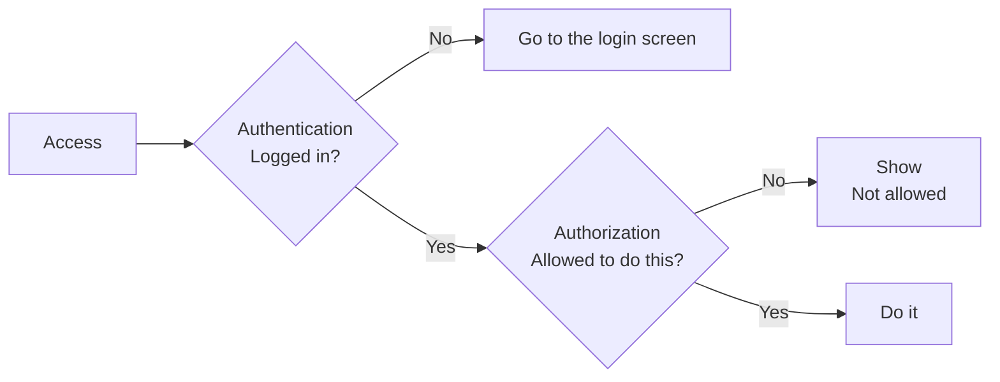
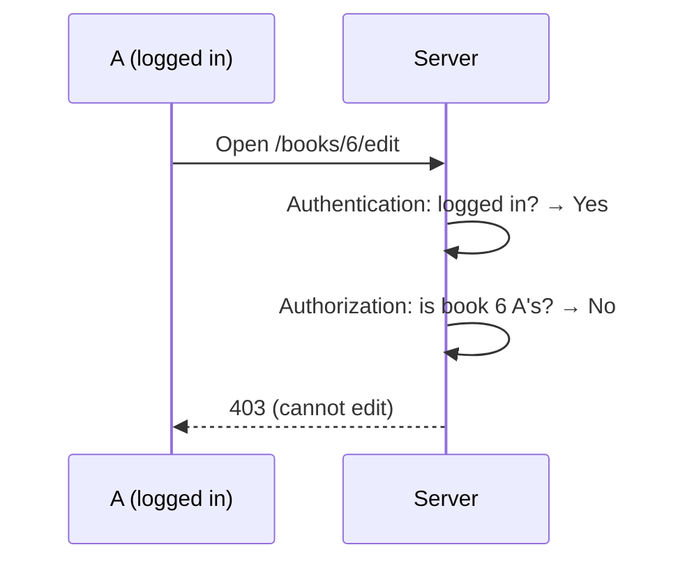
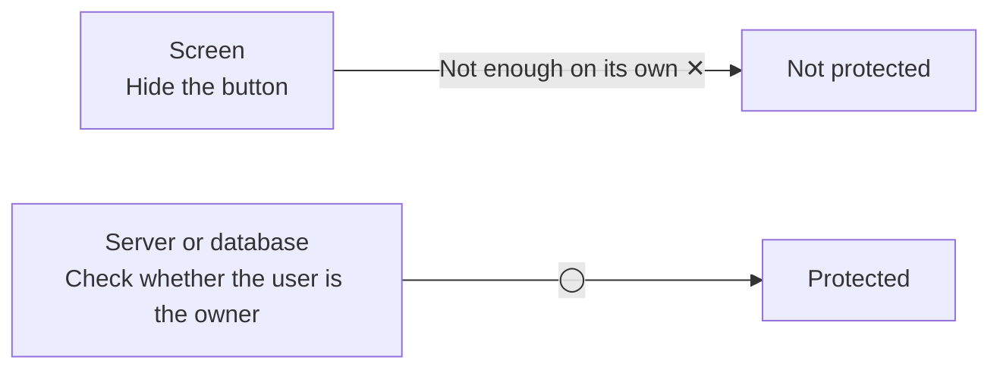

# About Authentication and Authorization

> 🇯🇵 Original (Japanese version): [認証と認可について.md](<../../../2年生_システム開発実践/後期/2026_11_13/認証と認可について.md>) <!-- original-ja-link -->

When you build a login feature, two terms come up: **authentication** and **authorization**.
The words look similar, but they mean different things.

[Back to the Free Project](../2026_10_09/2026_10_09_資料1.md)

---

## 1. In a Nutshell

| Name | Abbreviation | What it checks | In a nutshell |
|------|-----|-----------|-----------|
| **Authentication** | Authentication, abbreviated as **AuthN** | **Who are you?** | Identity check |
| **Authorization** | Authorization, abbreviated as **AuthZ** | **What are you allowed to do?** | Permission check |

> 💡 **Think of it like a concert**
> - **Authentication** = showing your **ticket and ID** at the entrance so they can confirm it's really you
> - **Authorization** = **where you can go depends on your ticket type** (people with general seats can't enter the staff area)
>
> Even once they know it's you (authentication OK), that doesn't mean you can go anywhere (authorization is separate).

---

## 2. The Order Is "Authentication → Authorization"

**If you don't know who someone is, you can't decide what they're allowed to do.** That's why authentication always comes first.



---

## 3. Let's Apply It to Your Own App

Let's think about it using the **reading log app** as an example.

| Situation | Authentication or authorization? | What it checks |
|-----|-----------|-----------|
| Logging in with an email address and password | **Authentication** | Is this person really who they claim to be? |
| Someone who isn't logged in opens the "Add a book" page | **Authentication** | Logged in? → If not, go to the login screen |
| A tries to edit **B's** thoughts on a book | **Authorization** | Did I add this book? → If not, it's not allowed |
| Only admins can delete other people's posts | **Authorization** | Is this person an admin? |

> ⚠️ **A common mistake: doing authentication but forgetting authorization**
> If all you do is "only logged-in users can open the edit page," then **any** logged-in user can edit **other people's data** just by changing the number in the URL.
>
> ```
> /books/5/edit   ← my book
> /books/6/edit   ← change the number and... someone else's book?
> ```
>
> When editing or deleting, always check: **"Does this data belong to the person who's logged in?"**

An authorization check can stop even logged-in users from editing other people's data, as shown below.



---

## 4. HTTP Status Codes

The status codes returned for errors are also different for authentication and authorization.

| Code | Name | Meaning |
|-------|-----|------|
| **401** | Unauthorized | Not **authenticated** (not logged in; we don't know who you are) |
| **403** | Forbidden | Authenticated, but not **authorized** (that action is forbidden) |

> 📝 The name of 401 is "Unauthorized" (not authorized), but it actually means **not authenticated**. The name is confusing, so remember it by its meaning.

---

## 5. How Is It Done in Each Technology?

### With Laravel

| | What to use | Example |
|---|---|---|
| Authentication | `Auth`, the `auth` middleware | Send people who aren't logged in to the login screen |
| Authorization | **Policy**, `Gate` | Write a rule like "only the person who added a book can edit it" |

```php
// routes/web.php: logged-in users only (authentication)
Route::middleware('auth')->group(function () {
    Route::get('/books/{book}/edit', [BookController::class, 'edit']);
});
```

```php
// BookController: is it your own book? (authorization)
public function edit(Book $book)
{
    if ($book->user_id !== Auth::id()) {
        abort(403); // 403 if it isn't your book
    }

    return view('books.edit', compact('book'));
}
```

### With Supabase

| | What to use | Example |
|---|---|---|
| Authentication | **Supabase Auth** | Log in with an email and password, or with a Google account |
| Authorization | **RLS (Row Level Security)** | Write a rule in the database like "you can only view and change rows whose `user_id` matches your user ID" |

> ⚠️ **RLS is very important in Supabase**
> With Supabase, the browser **accesses the database directly**.
> If you don't set up RLS, you may end up in a state where **anyone can view or delete all the data**.
> In the Supabase dashboard, check that RLS is **turned on (Enabled)** for each table.

---

## 6. Just Hiding Things on the Screen Isn't Authorization

"Don't show the edit button on other people's books"—this is a **UI technique**, **not authorization**.
Even without the button, someone can still perform the action by typing the URL or calling the API directly.



**Always do authorization checks on the server side (Laravel controllers, Supabase RLS, etc.).**

---

## 7. Summary

- **Authentication** = **Who are you?** (identity check, login)
- **Authorization** = **What are you allowed to do?** (permission check)
- The order is **authentication → authorization**
- Not logged in → **401**; logged in but forbidden → **403**
- Laravel uses **auth middleware + Policy**; Supabase uses **Supabase Auth + RLS**
- Hiding the button alone doesn't protect your data. **Always check on the server side**

[Back to the Free Project](../2026_10_09/2026_10_09_資料1.md)
