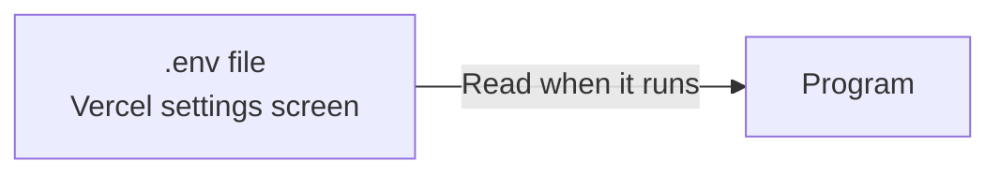
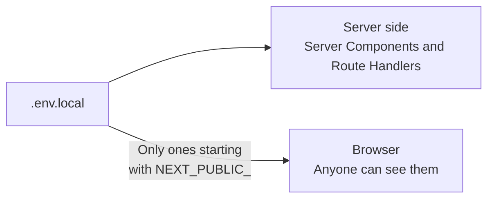
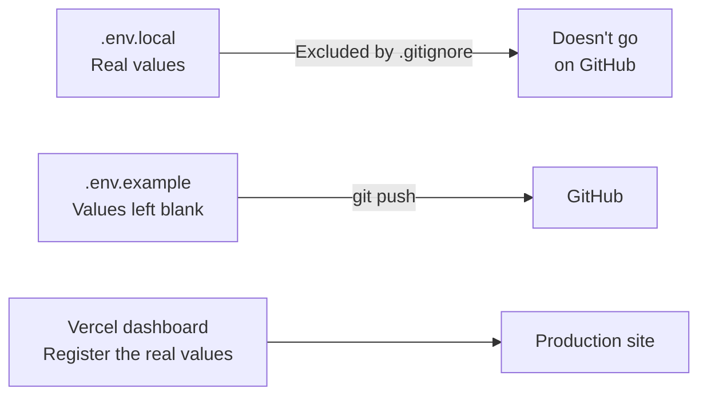
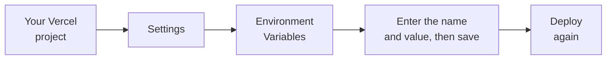

# About Environment Variables

> 🇯🇵 Original (Japanese version): [環境変数について.md](<../../../2年生_システム開発実践/後期/2026_11_27/環境変数について.md>) <!-- original-ja-link -->

In the free-project handouts, we've said many times, "**Don't put API keys or passwords on GitHub**" and "Write them in `.env`."
The values you write in this `.env` file are **environment variables**.
Here, we'll look at what environment variables are and why we use them.

[Back to the Free Project](../2026_10_09/2026_10_09_資料1.md)

---

## 1. What Are Environment Variables?

**Environment variables** are configuration values kept **outside** the program.
When the program runs, it **reads** those values and uses them.



| What to put in environment variables | Examples |
|------------------|-----|
| **Secret values** | API keys, database passwords |
| **Values that change depending on where the program runs** | The database location (your own PC or the production server), the API URL |

> 💡 **Think of it like a "house key"**
> It's fine to show other people the **blueprint** of your house (the program).
> But you don't tape the **key** (the password) to the blueprint—you **keep it separately**, right?
> Environment variables are like a **key** you keep separate from the program.

---

## 2. Why Use Environment Variables?

### ① To keep secret values off GitHub

If you **write an API key directly** in your program and publish it on GitHub, **anyone in the world can see it**.

```js
// ✕ Dangerous: written directly in the code
const apiKey = "sk-abc123xyz...";
```

```js
// ◯ Safe: read from an environment variable
const apiKey = process.env.WEATHER_API_KEY;
```

> ⚠️ **Keys posted on GitHub get misused right away**
> There are programs that automatically search public repositories for keys.
> If you accidentally push a key, **just deleting the commit isn't enough** (it stays in the history).
> Right away, go to the service's dashboard, **disable the key, and create a new one**.

### ② To switch values depending on where the program runs

The same program connects to different places when it runs on **your own PC** and in **production (Vercel, etc.)**.

| | Your own PC (development environment) | Production environment |
|---|---|---|
| Database | MySQL on your own PC | A database on the internet |
| API URL | `http://localhost:8000` | `https://〇〇.com` |

You can switch where it connects just by changing the environment variables, **without changing** the program.
They're called **environment variables** because they're "**variables** that change depending on the **environment**."

---

## 3. The `.env` File

During development, you write environment variables in a file named `.env`.

### With Laravel (`.env`)

```
APP_NAME=BookApp
DB_HOST=127.0.0.1
DB_DATABASE=laravel
DB_USERNAME=laravel
DB_PASSWORD=password
```

```php
// Reading it (inside a config file)
'database' => env('DB_DATABASE'),
```

### With Next.js (`.env.local`)

```
WEATHER_API_KEY=abc123xyz
NEXT_PUBLIC_SUPABASE_URL=https://〇〇.supabase.co
```

```js
// Reading it
const apiKey = process.env.WEATHER_API_KEY;
```

> ⚠️ **Be careful with `NEXT_PUBLIC_` in Next.js**
> Environment variables whose names start with `NEXT_PUBLIC_` are **sent to the browser, where anyone can see them**.
> **Don't add `NEXT_PUBLIC_` to secret values (API keys, etc.).**
> Environment variables without `NEXT_PUBLIC_` can only be used on the server side (in Server Components and Route Handlers).

The following diagram shows where the values are available.



> 📝 Supabase's **URL and public key (publishable key / anon key)** are meant to be used in the browser, so it's fine to add `NEXT_PUBLIC_` to them.
> However, you must set up **RLS** to protect your data (→ [About Authentication and Authorization](../2026_11_13/認証と認可について.md)).
> On the other hand, the **secret key / service_role key** can do anything, so never add `NEXT_PUBLIC_` to it.

---

## 4. How `.env` Is Kept Off GitHub

`.env` doesn't end up on GitHub because it's listed in **`.gitignore`**.

```
# .gitignore
.env
.env*.local
```

Files listed in `.gitignore` are **ignored by Git**, so they don't get committed.
Projects created with Laravel or `create-next-app` **already have these lines from the start**.

### Prepare a `.env.example`

Since `.env` doesn't go on GitHub, other people looking at your project can't tell **which environment variables are needed**.
So you create `.env.example`, **a sample with the values left blank**, and put that on GitHub.

```
# .env.example (put this on GitHub)
WEATHER_API_KEY=
NEXT_PUBLIC_SUPABASE_URL=
```

> 💡 Laravel comes with `.env.example` from the start. When you show your project as part of your portfolio, having a `.env.example` gives the impression that it's **well put together**.

---

## 5. In Production (Vercel), Set Them in the Dashboard

`.env.local` doesn't go on GitHub, so **it doesn't reach Vercel**.
You set production environment variables in the Vercel dashboard.

Here's a summary of what goes on your own PC, on GitHub, and on Vercel.



Here are the steps to set them.



> ⚠️ **After adding or changing environment variables, deploy again**
> Environment variables are read **at deploy time**. Just setting them won't affect the site that's currently running.

---

## 6. Summary

- **Environment variables** = configuration values kept **outside** the program
- We use them to **protect secret values** and to **switch values depending on the environment**
- During development, write them in **`.env`** (`.env.local` for Next.js). **`.gitignore`** keeps them off GitHub
- Put **`.env.example`** on GitHub as a sample of the environment variables you need
- With Next.js, environment variables prefixed with **`NEXT_PUBLIC_`** are fully visible in the browser. Don't use this prefix for secret values
- In production (Vercel), **set them in the dashboard** and **deploy again**
- If you push a key by mistake, **disable it and create a new one right away**

[Back to the Free Project](../2026_10_09/2026_10_09_資料1.md)
