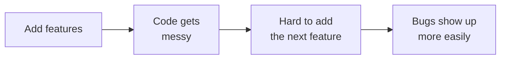
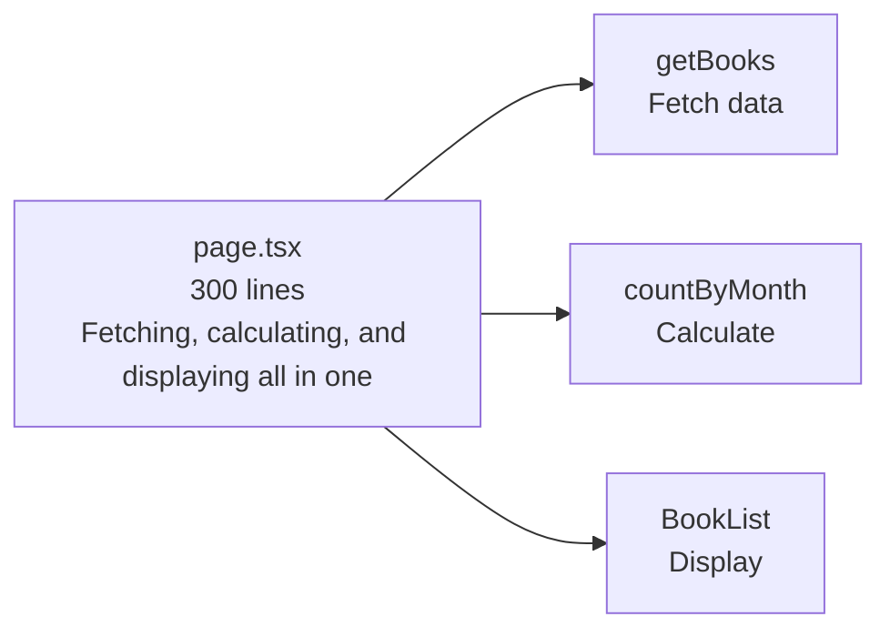
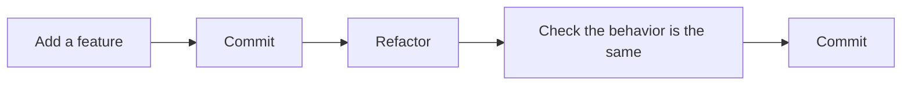

# About Refactoring

> 🇯🇵 Original (Japanese version): [リファクタリングについて.md](<../../../2年生_システム開発実践/後期/2026_12_04/リファクタリングについて.md>) <!-- original-ja-link -->

As you keep adding features, your code gets longer and you start **losing track of where everything is**.
That's when you do **refactoring**.

[Back to the Free Project](../2026_10_09/2026_10_09_資料1.md)

---

## 1. What Is Refactoring?

**Refactoring** means **reorganizing your code so it's easier to read and easier to fix**, **without changing how the app behaves**.

| | Behavior (what users see) | Inside the code |
|---|---|---|
| Adding a feature | **Changes** | Changes |
| Fixing a bug | **Changes** (becomes correct) | Changes |
| **Refactoring** | **Doesn't change** | Changes (becomes cleaner) |

> 💡 **Think of it like "tidying up your room"**
> Tidying your room doesn't change the things you own (what you can do).
> But because you know where everything is, **it's easier the next time you look for something or put something new away**.

---

## 2. Why Refactor?



- When code is messy, **adding the next feature takes longer**
- When the same code is scattered all over, **forgetting to update even one spot** can cause a bug
- Six months from now, you'll **barely remember** the code you're writing today
- When reviewing your portfolio, people at companies **look at your code too**. Readable code makes a good impression

---

## 3. Signs That Code Needs Refactoring

Messy code tends to follow common patterns. These are called **code smells** (the code "smells").

| Sign | Example |
|-------|-----|
| **The same code appears in many places** | The same header is copied onto every page |
| **A single function or file is too long** | `page.tsx` is 300 lines long |
| **Names are hard to understand** | `data`, `tmp`, `a`, `flg` |
| **Numbers whose meaning is unclear** | `if (status === 2)` (what does 2 mean?) |
| **Unused code** | Old code left commented out |

---

## 4. Common Refactorings

### ① Make names easier to understand

```js
// ✕ Can't tell what's inside
const d = await getData();
const l = d.filter((x) => x.r >= 4);
```

```js
// ◯ You can tell just by looking at the names
const books = await getBooks();
const favoriteBooks = books.filter((book) => book.rating >= 4);
```

This is the easiest and most effective refactoring.

### ② Consolidate duplicate code

Turning code into **reusable parts (components or `@include`)**, which you learned about last semester or in your first year, is also refactoring.

```jsx
// ✕ The same card markup is repeated on page after page
<div className="rounded border p-4">
  <h2 className="font-bold">{book.title}</h2>
  <p>{book.author}</p>
</div>
```

```jsx
// ◯ Create a component called BookCard and use it anywhere
<BookCard book={book} />
```

This way, when you want to change how the card looks, **you only have to fix one place**.
The idea of not repeating the same thing is called **DRY** (Don't Repeat Yourself).

### ③ Give names to numbers with unclear meanings

```js
// ✕ Can't tell what 2 means
if (book.status === 2) { ... }
```

```js
// ◯ Give it a name
const STATUS_FINISHED = 2; // Finished reading
if (book.status === STATUS_FINISHED) { ... }
```

### ④ Split long functions and files

When one function is **doing lots of different things**, split it up by job.



---

## 5. Rules for Refactoring

### Rule ①: Commit first

Before refactoring, **commit the working state**.
That way, even if you break something, you can **go back right away**.

### Rule ②: Don't do it at the same time as adding features

If you "clean up while adding a feature," then when something stops working, **you can't tell which one caused it**.



### Rule ③: Do it little by little

Don't try to fix everything at once. Repeat: **fix one thing, then check**.

### Rule ④: When you're done, make sure the behavior hasn't changed

The rule of refactoring is **not to change the behavior**.
After you make changes, always check that it **works the same as before**.
**Tests**, which we'll learn about next time, do this checking for you automatically.

---

## 6. Getting AI to Help with Refactoring

If you ask AI, "Refactor this code to make it easier to read," it will give you cleaned-up code.
But keep the following in mind.

- **Check for yourself** that the behavior hasn't changed (AI can make mistakes too)
- **Understand why it was changed that way** before using it. If you can't explain the code, you'll be in trouble when asked about it in an interview
- Don't ask for a lot at once. Ask **one file at a time, one function at a time**

---

## 7. Summary

- **Refactoring** = cleaning up code so it's easier to read and easier to fix, **without changing the behavior**
- The signs are **the same code in many places, things that are too long, hard-to-understand names, numbers with unclear meanings**
- Common refactorings are **renaming, extracting reusable components (DRY), naming numbers, splitting up long code**
- **Commit first**, **don't do it while adding features**, **do it little by little**, **check that the behavior is the same**
- Even when you use AI, **understand it before** you use it

[Back to the Free Project](../2026_10_09/2026_10_09_資料1.md)
