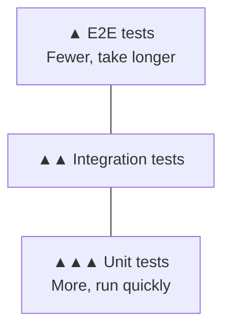

# About Testing

> 🇯🇵 Original (Japanese version): [テストについて.md](<../../../2年生_システム開発実践/後期/2026_12_11/テストについて.md>) <!-- original-ja-link -->

Once you've built an app, you need to check that it **actually works**. This is called **testing**.
In this lesson, we'll look at the different types of tests and how to run tests **automatically**.

[Back to Independent Project](../2026_10_09/2026_10_09_資料1.md)

---

## 1. What Is Testing?

**Testing** means checking whether a program **works the way you expect**.

You probably already check your code after writing it by **opening the page in a browser and clicking the buttons**, right?
That's a real test, too. Because a person does it by hand, it's called **manual testing**.

| | Manual testing | Automated testing |
|---|---|---|
| How it works | A person checks by interacting with the app | A **test program** does the checking |
| Time | The more there is to check, the **longer it takes** | Even hundreds of tests take **seconds to minutes** |
| Forgetting to check something | Can happen | **Never happens** (it does the same thing every time) |

---

## 2. Why Is Automated Testing Important?

When you add features or [refactor](../2026_12_04/リファクタリングについて.md) your code, **things that used to work can break**.
This is called a **regression**.


Rechecking **every feature by hand** every time you add a new one is a lot of work.
With automated tests, you can **recheck everything at once** with a single command.

> 💡 **Think of it like "checking answers on a test"**
> If you decide the **answer (the expected result)** ahead of time, like "the answer to this question is X,"
> then all you have to do is mechanically check **whether the result matches the answer**.

---

## 3. Types of Tests

Tests are grouped by **how much of the application they check**.

| Type | What it checks | Example |
|-----|-----------|-----|
| **Unit test** | Whether **one function or one component** works correctly | Does a "function that calculates the average rating" return `4` when given `[4, 5, 3]`? |
| **Integration test** | Whether **several components work correctly together** | When you call the "book registration API," is the book saved to the database? |
| **E2E test** (End to End) | Whether everything works from start to finish, **the way a user would use it** | Use an automated browser to log in → register a book → check that it appears in the list |



Smaller tests (unit tests) are **faster and easier to write**, so you write a lot of them.
Bigger tests (E2E tests) **take more time**, so you keep them to the most important flows.
Because of this shape, it's called the **test pyramid**.

---

## 4. Let's Look at How to Write Tests

### Unit test (JavaScript, Vitest example)

```js
// average.js: a function that calculates the average rating
export function average(ratings) {
  if (ratings.length === 0) return 0;
  const total = ratings.reduce((sum, r) => sum + r, 0);
  return total / ratings.length;
}
```

```js
// average.test.js: the tests
import { expect, test } from "vitest";
import { average } from "./average";

test("平均を計算できる", () => {
  expect(average([4, 5, 3])).toBe(4);
});

test("1つもないときは 0", () => {
  expect(average([])).toBe(0);
});
```

| Part | Meaning |
|-----|------|
| `test("〇〇", ...)` | The test's name and what it checks |
| `expect(A).toBe(B)` | **A should be B** (the expected result) |

### Integration test (Laravel example)

Laravel comes with testing tools built in.

```php
// tests/Feature/BookTest.php
public function test_本を登録できる(): void
{
    $response = $this->post('/books', [
        'title' => 'こころ',
        'author' => '夏目漱石',
    ]);

    $response->assertRedirect('/books');                      // Goes back to the list
    $this->assertDatabaseHas('books', ['title' => 'こころ']); // Saved in the DB
}
```

```powershell
php artisan test
```

> 📝 In Laravel, there are two ways to write tests: **PHPUnit** and **Pest**. The example above uses PHPUnit. The style depends on which one you chose when you created the project, so take a look at the examples in the `tests` folder.

---

## 5. Test Results

When you run your tests, the results are displayed.

| Display | Meaning |
|-----|------|
| ✅ PASS (green) | The result was as expected |
| ❌ FAIL (red) | The result was not as expected → it shows which test failed and what was different |

> 💡 **Run tests automatically with CI**
> If you add your test command to **GitHub Actions**, which you learned about in [About CI/CD](../2026_10_09/CICDについて.md),
> your tests will **run automatically every time you push**. You'll notice broken code right away.

---

## 6. What Should You Test?

You don't need to test everything. Start with areas like these:

- **The most important features** (your MVP features)
- **Code that performs calculations** (totals, averages, date calculations, etc.)
- **Places where mistakes are easy to make** (when there are 0 items, when the input is empty, when the input is very long)
- **Places where a bug has happened before** (so the same bug doesn't come back)

> 💡 **It makes your portfolio stand out**
> Not many students write tests for their portfolio projects.
> Even a few tests for your important features show that you **build software with quality in mind**.

---

## 7. Summary

- **Testing** = checking whether a program **works the way you expect**
- In **manual testing**, a person checks; in **automated testing**, a program checks
- With automated tests, you can quickly check for **regressions** after adding features or refactoring
- The types are **unit tests, integration tests, and E2E tests**. Write more small tests (the **test pyramid**)
- You compare against the **expected result**, as in `expect(A).toBe(B)`
- Combined with **GitHub Actions**, your tests run automatically every time you push

[Back to Independent Project](../2026_10_09/2026_10_09_資料1.md)
