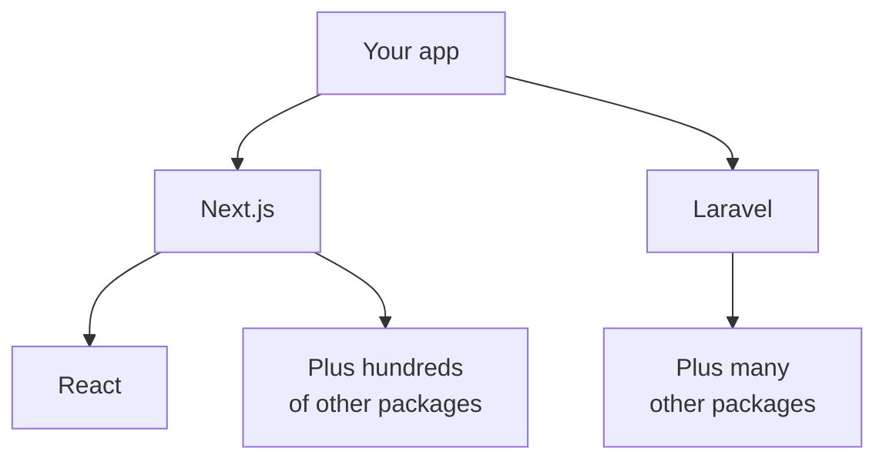
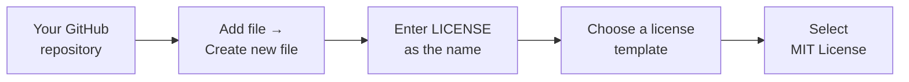

# About OSS and Licenses

> 🇯🇵 Original (Japanese version): [OSSとライセンスについて.md](<../../../2年生_システム開発実践/後期/2026_12_18/OSSとライセンスについて.md>) <!-- original-ja-link -->

Laravel, Next.js, React, and Tailwind CSS, which you're using in your independent project, are all **free** to use.
That's because they are **OSS (open source software)**.
In this lesson, we'll look at OSS and the **licenses** you need to follow when you use it.

[Back to Independent Project](../2026_10_09/2026_10_09_資料1.md)

---

## 1. What Is OSS?

**OSS (Open Source Software)** is software whose **source code (the instructions that make up the program) is public**, and that
**anyone can freely use, modify, and share**, as long as they follow certain rules.

| | OSS | Non-OSS software |
|---|---|---|
| Source code | **Public** | Not public (kept inside the company) |
| Modifying | Allowed if you follow the rules | Not allowed |
| Examples | Laravel, Next.js, React, MySQL, Linux, the code VS Code is built on | Windows, Microsoft Office, Photoshop |

> 💡 **Think of it like "sharing a recipe"**
> You post a recipe online and say, "Feel free to make it. Changing it up is OK too. But **please credit the original recipe's author**."
> That's the idea behind OSS. The "but..." part is the **license**.

---

## 2. OSS All Around You

Your independent project app is actually **built mostly out of OSS**.

The things you install with `npm install` or `composer install` (the contents of `node_modules` and `vendor`) are almost all OSS.
Thanks to OSS made by people all over the world, you can build apps **without making everything from scratch**.

---

## 3. What Is a License?

A **license** is a set of **rules** that says **how you're allowed to use** a piece of software.
You can use OSS freely, but that **doesn't mean you can do anything you want**. You need to follow the rules written in the license.

### Common licenses

| License | How permissive | Rules (simplified) | Used by |
|----------|------|-----------------|-----------|
| **MIT** | Very permissive | You can use it for anything (even paid apps) **as long as you keep the copyright notice and license text** | Laravel, Next.js, React, Tailwind CSS |
| **Apache 2.0** | Permissive | Almost the same as MIT, with a few more rules, such as **stating what you changed** | TypeScript, Kubernetes |
| **GPL** | Fairly strict | If you **distribute** software that uses GPL code, you **must also release your own code under the GPL** | Linux, WordPress |

> 📝 **Licenses like the GPL are called "copyleft"**
> The idea is: "You can use this freely, but anything you make with it must be **just as free**."
> When companies build apps, they **always check** the licenses of the OSS they use.

---

## 4. Adding a License to Your Own App

You can also add a license to your own repositories that you've published on GitHub.

> ⚠️ **Without a license, other people can't use it freely**
> Even if your repository is public, without a license, **other people do not have permission to use or modify your code**.
> If you want people to use it freely, choose MIT. If you only want people to look at it (and not use it), leave out the license.

---

## 5. It's Not Just Code That Has "Rights"

The **images, illustrations, icons, fonts, and music** you put in your app are also protected by their creators' **copyright**.

| ✕ Don't do this | ◯ Do this instead |
|----------------|----------|
| Use an image you found by searching online as is | Use **free-to-use assets** (check the terms of use) or images you made or took yourself |
| Put character images from anime or games in your app and publish it | Don't use them in apps you publish. If you do use them, check the **official guidelines** |
| Use free assets without reading their terms of use | Follow the terms of use, such as requirements to credit the creator |

> 💡 **Open source icons and fonts are handy**
> There are free options available, like **Heroicons and Lucide** for icons and **Google Fonts** for fonts.
> Check their licenses before using them.

> ⚠️ **Be especially careful with your portfolio**
> Your portfolio is **something you show to people at companies**. If it includes images that violate someone's rights, that alone can leave a **very bad impression**.

---

## 6. Giving Back to OSS

OSS is made by people all over the world, **as volunteers or as part of their jobs**. Besides using OSS, you can also give back.

| Way to give back | What it means |
|-----------|------|
| ⭐ **Star** | Star the GitHub repositories of the OSS you use (the easiest way) |
| 🐛 **Issue** | If you find a bug, report it in an Issue |
| 📝 **Fix the documentation** | Fix mistakes or typos in the documentation with a pull request |
| 🔧 **Fix the code** | Send a pull request that fixes a bug |

Having a pull request accepted by an OSS project is a **big selling point** when you're job hunting.

---

## 7. Summary

- **OSS** = software whose source code is public and that **anyone can use and modify** as long as they follow the rules
- Laravel, Next.js, and React are OSS too. Your app is **built mostly out of OSS**
- **License** = the rules for how you're allowed to use something. Examples include **MIT** (very permissive) and **GPL** (may require you to release your own code too)
- You can add a license to your own repository with a **LICENSE** file
- Images, icons, fonts, and music are also protected by **copyright**. Be especially careful with your portfolio
- Besides just using OSS, you can give back with **stars, Issues, and pull requests**

[Back to Independent Project](../2026_10_09/2026_10_09_資料1.md)
